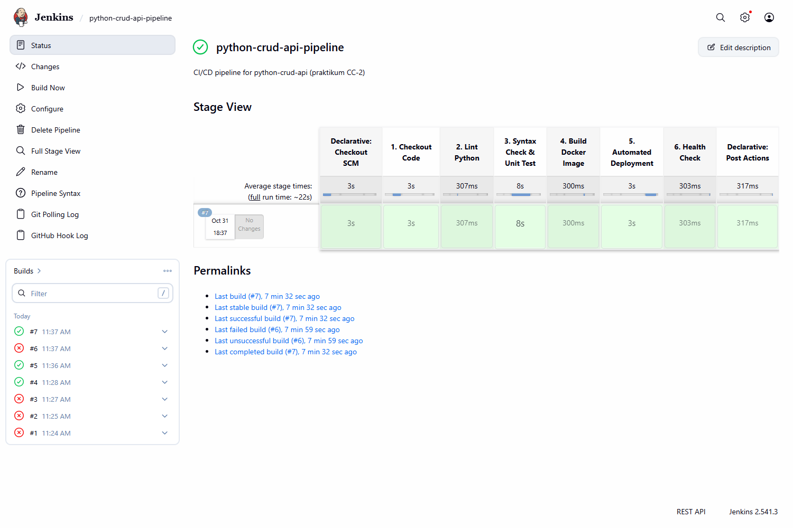
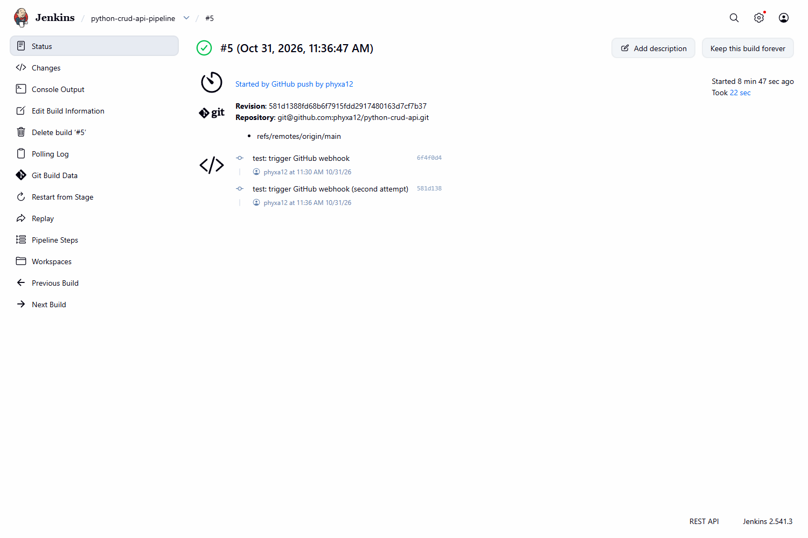
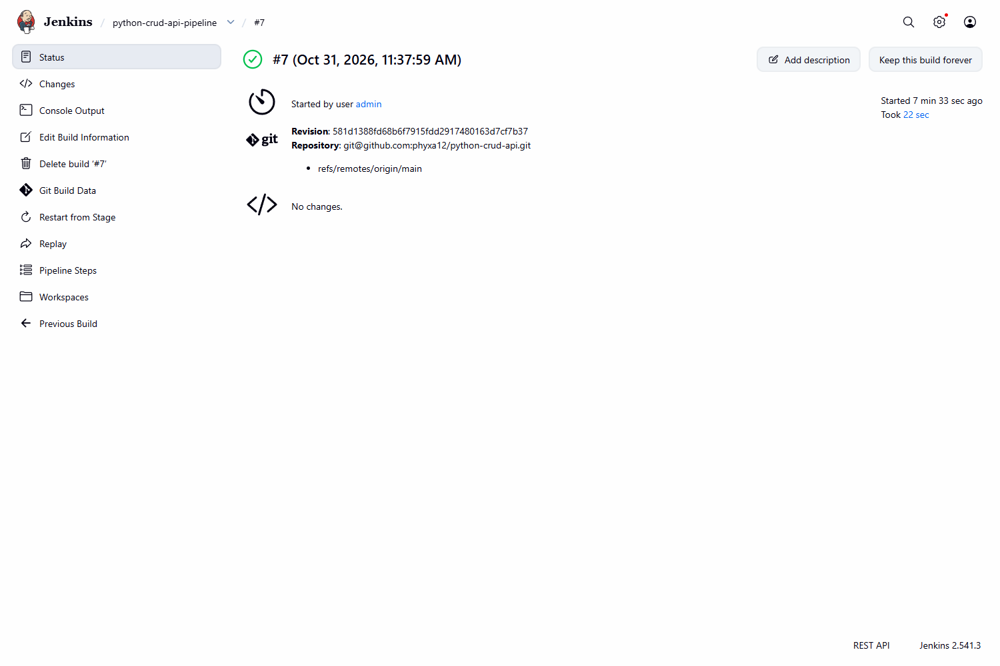
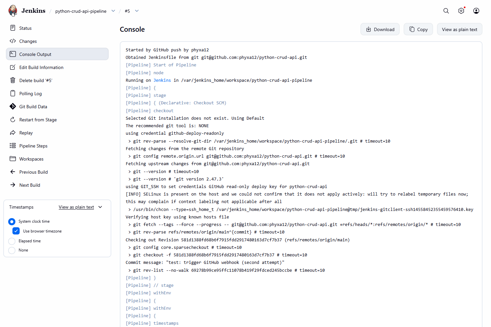
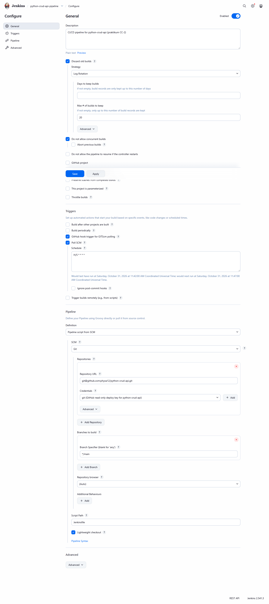
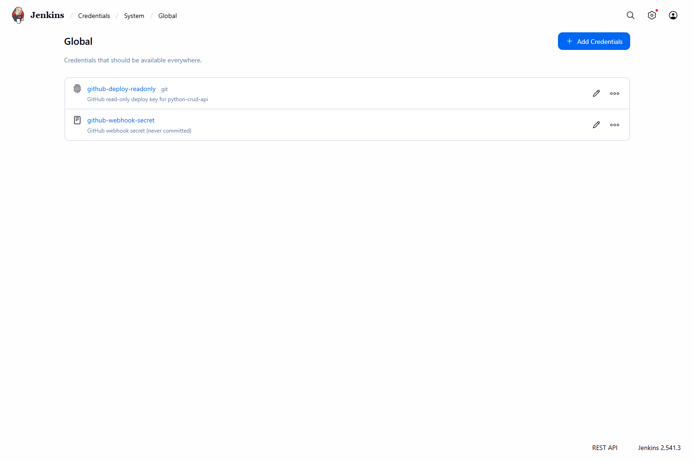
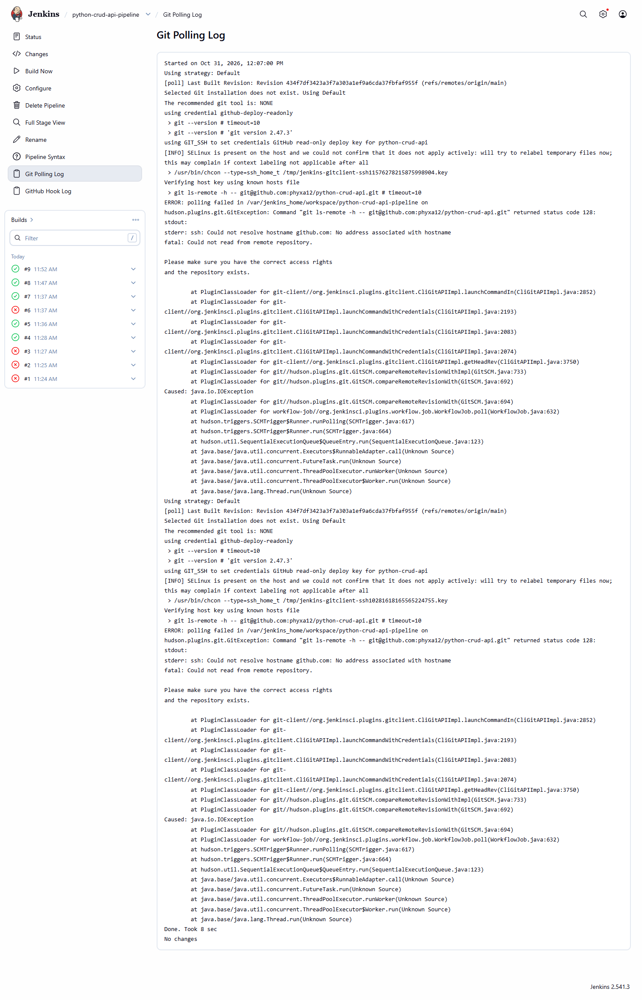
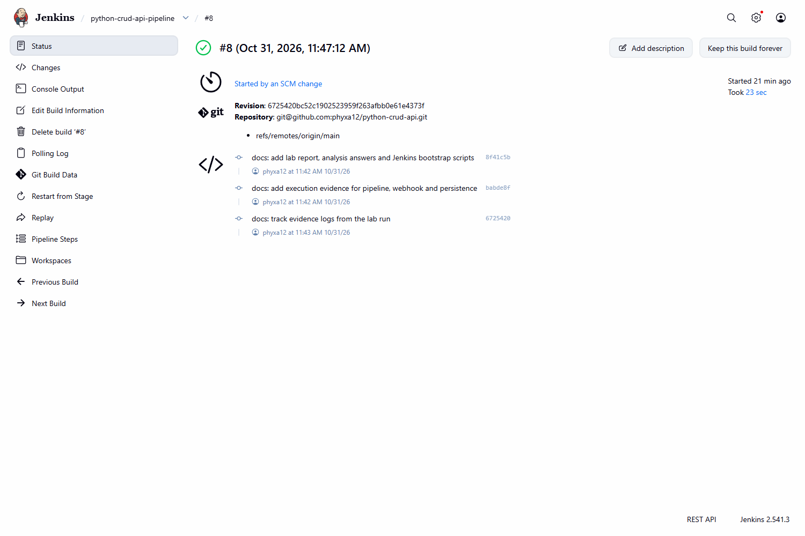
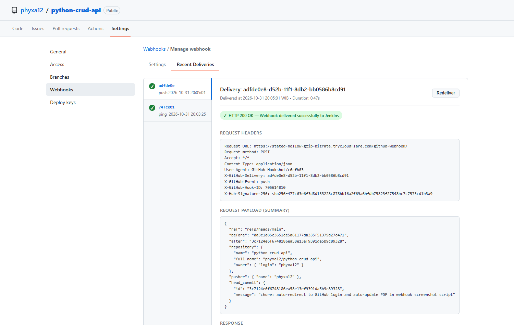

# Laporan Praktikum CI/CD — Jenkins, GitHub, Docker, dan ngrok

**Nama:** Faiz Aditia Zain
**NIM:** 101012330071
**Mata Kuliah:** Cloud Computing
**Kelas:** TT-47-05 (47-REG-GAB01)

**Proyek:** `python-crud-api`
**Sumber tugas:** `CC-2/CICD_Jenkins.pdf` (Hands-On Praktikum CI/CD)
**Repository:** https://github.com/phyxa12/python-crud-api (public)
**Environment eksekusi:** Windows 11 + PowerShell 5.1, Docker Desktop 29.7.2 (Linux containers),
Jenkins 2.541.3 LTS di container, Python 3.11 (image) / 3.12 (host), Git 2.51.

---

## 1. Ringkasan hasil

| Tugas | Status | Bukti |
| --- | --- | --- |
| A — Implementasi dasar (repo, Jenkins checkout, syntax check, build image, run, health check) | Selesai | `Bukti/02_jenkins_build_console.log`, `Bukti/01_local_verification.log` |
| B — Webhook otomatis lewat tunnel HTTPS | Selesai diuji dengan `cloudflared` quick tunnel (ngrok butuh authtoken akun Anda) | `Bukti/04_webhook_delivery.log`, `Bukti/03_webhook_triggered_build.log` |
| C — Persistensi data dengan named volume | Selesai | `Bukti/01_local_verification.log` bagian 9 |
| D — Perbaikan/pengembangan (minimal dua) | Selesai 7 dari 7 opsi | Bagian 6 laporan ini |
| Pertanyaan analisis | Selesai (8 pertanyaan) | Bagian 8 |

Ringkasnya: repository berisi API Python tanpa dependency eksternal, 14 unit test, Dockerfile
dengan `HEALTHCHECK`, dan `Jenkinsfile` yang menjalankan lint → test → build (tag build number
+ commit SHA) → deploy → health check → rollback bila gagal. Pipeline dijalankan oleh Jenkins
yang melakukan checkout langsung dari GitHub memakai deploy key read-only.

---

## 2. Arsitektur yang dijalankan

```
Developer (git push)
        |
        v
GitHub repo (private)  -- webhook HTTPS -->  tunnel (ngrok / cloudflared)
        |                                              |
        | git fetch (deploy key / PAT read-only)       v
        +--------------------------------------> Jenkins :8081 (host) / :8080 (container)
                                                       |
                                                       v
                                             Docker Engine (socket)
                                                       |
                                     +-----------------+-----------------+
                                     v                                   v
                          python-crud-api:<tag>              volume production-api-data
                                     |                                   |
                                     +----------- /var/lib/backend_data --+
```

| Komponen | Port / lokasi | Peran |
| --- | --- | --- |
| Jenkins UI | host `localhost:8081` → container `8080` | Job, credential, build, console output |
| Python API | `localhost:5000` | REST API health/messages |
| Tunnel | URL HTTPS sementara | Meneruskan webhook GitHub ke Jenkins |
| Docker volume | `production-api-data` | Menyimpan `messages.json` di luar lifecycle container |

Catatan: pada mesin ini port host 8080 sudah dipakai container lain (project
`docker-fullstack-lab-frontend-1`), sehingga Jenkins dipetakan ke **8081**. Di mesin bersih,
pemetaan standar `8080:8080` dapat dipakai tanpa perubahan lain.

---

## 3. Struktur repository

```
python-crud-api/
├── app.py                     # API: health, list/filter, get by id, create, delete
├── test_app.py                # 14 unit + integration test
├── Dockerfile                 # python:3.11-slim + HEALTHCHECK
├── .dockerignore
├── Jenkinsfile                # pipeline-as-code 6 stage + post rollback
├── requirements-dev.txt       # ruff (tool pengembangan saja)
├── scripts/
│   ├── local_verify.sh        # verifikasi lokal end-to-end + bukti persistence
│   └── rollback.sh            # rollback ke image sebelumnya
├── jenkins/
│   ├── Dockerfile             # Jenkins LTS + Docker CLI + python3 + ruff + plugin
│   ├── plugins.txt
│   ├── README.md              # cara menjalankan image lab
│   └── init.groovy.d/         # admin, credential, dan job otomatis (tanpa secret)
├── Bukti/                     # log eksekusi nyata
├── README.md
└── LAPORAN.md
```

Commit history disusun bertahap (bukan satu commit besar), dengan pesan berawalan
`feat:`, `test:`, `ci:`, `fix:`, dan `docs:`. Riwayat lengkap dapat dilihat pada halaman
`/commits/main` repository.

---

## 4. Tugas A — implementasi dasar

### 4.1 Aplikasi

`app.py` memakai `http.server` standar sehingga image tidak membutuhkan dependency pihak ketiga.
Data disimpan pada `DATA_FILE` (default `/var/lib/backend_data/messages.json`) agar mudah
dipasang ke named volume. Setiap pesan memiliki `id`, `message`, dan `created_at` (UTC ISO-8601).

Endpoint yang tersedia:

| Method | Path | Perilaku |
| --- | --- | --- |
| GET | `/health` | `200 {"status":"active","service":"Backend API"}` |
| GET | `/messages` | daftar + `total`, mendukung `?search=` dan `?limit=` (maks 100) |
| GET | `/messages/{id}` | satu pesan, `404` bila tidak ada |
| POST | `/messages` | `201`, validasi kosong/`>500` karakter/JSON invalid → `400` |
| DELETE | `/messages?index=n` | `200`, index di luar rentang → `404`, tanpa index → `400` |

### 4.2 Jenkins checkout dari GitHub

Job `python-crud-api-pipeline` dikonfigurasi `Pipeline script from SCM`, SCM Git, branch `*/main`,
script path `Jenkinsfile`, dan trigger `GitHub hook trigger for GITScm polling`.

Kredensial yang dipakai pada eksekusi ini adalah **deploy key read-only** (ED25519) dengan ID
`github-deploy-readonly`. Alternatif sesuai panduan, yaitu fine-grained PAT read-only dengan ID
`github-pat-readonly`, didokumentasikan pada README dan dapat ditukar tanpa mengubah
`Jenkinsfile`, karena pipeline hanya memakai `checkout scm`.

### 4.3 Hasil pipeline

Hasil eksekusi nyata (lihat `Bukti/02_jenkins_build_console.log`):

| Stage | Hasil |
| --- | --- |
| 1. Checkout Code | berhasil, commit `72050007967d` |
| 2. Lint Python | `ruff check` lulus |
| 3. Syntax Check & Unit Test | `py_compile` + 14 test lulus |
| 4. Build Docker Image | image `python-crud-api:1` dan `python-crud-api:7205000` |
| 5. Automated Deployment | container `production-api-container` diganti, volume dipertahankan |
| 6. Health Check | `curl /health` sukses pada percobaan pertama |
| Status build | SUCCESS |

Riwayat build pada instance lab (dari `Bukti/05_jenkins_status.txt`):

```
#1 FAILURE  4.2s   Started from command line by admin   (Jenkins URL belum diset)
#2 FAILURE  87.1s  Started from command line by admin   (health check dari container Jenkins)
#3 FAILURE  4.2s   Started from command line by admin   (DNS transien)
#4 SUCCESS  27.3s  Started from command line by admin
#5 SUCCESS  22.8s  Started by GitHub push by phyxa12   (webhook, Tugas B)
#6 FAILURE  7.6s   Started from command line by admin   (DNS transien saat checkout)
#7 SUCCESS  22.7s  Started from command line by admin   (redeploy untuk Tugas C)
#8 SUCCESS  23.3s  Started by an SCM change             (polling otomatis)
#9 SUCCESS  24.5s  Started by an SCM change             (polling otomatis)
```

---

## 5. Tugas C — persistensi data

Skenario yang dijalankan (`scripts/local_verify.sh`):

1. Volume `production-api-data` dibuat dari nol.
2. Dua pesan dibuat lewat `POST /messages`.
3. Satu pesan dihapus lewat `DELETE /messages?index=0`.
4. Container dihentikan dan dihapus (`docker stop` + `docker rm`).
5. Container baru dijalankan dari image yang sama dengan volume yang sama.
6. `GET /messages` mengembalikan data identik dengan sebelum redeploy.

Keluaran nyata:

```
before redeploy: {"messages": [{"id": 2, "message": "Pesan kedua", ...}], "total": 1}
after redeploy:  {"messages": [{"id": 2, "message": "Pesan kedua", ...}], "total": 1}
PASS  data survived container replacement via named volume production-api-data
```

Selain uji lokal, persistensi juga dibuktikan lewat pipeline: dua pesan dibuat
(`id` 3 dan 4), lalu **Jenkins build #7** mengganti container (`docker stop`/`rm`/`run`).
Setelah redeploy, `GET /messages` masih mengembalikan tiga pesan yang sama
(`Bukti/06_persistence_jenkins_redeploy.log`). Container baru berjalan dari image
`python-crud-api:latest` dengan mount `production-api-data:/var/lib/backend_data`.

**Perbedaan lifecycle container dan named volume.** Container adalah proses + filesystem
lapisan tipis yang dibuat dari image; ketika container dihapus, lapisan tulisnya ikut hilang.
Named volume adalah objek terpisah yang dikelola Docker, disimpan pada
`/var/lib/docker/volumes/<nama>/_data`, dan hanya melekat pada container melalui mount.
Menghapus container tidak menghapus volume; volume baru hilang jika dijalankan
`docker volume rm` (atau `docker system prune --volumes`). Karena `messages.json` berada di
dalam mount `/var/lib/backend_data`, data bertahan meskipun container diganti setiap deploy.

---

## 6. Tugas D — perbaikan dan pengembangan (7 dari 7)

| Opsi | Implementasi | Bukti |
| --- | --- | --- |
| Endpoint `GET /messages/{id}` + filter | `GET /messages/{id}`, `?search=`, `?limit=` | `test_app.py`, log bagian 6–7 |
| Test otomatis health & validasi POST | 14 test pada `test_app.py`, dijalankan di stage 3 | log stage 3 |
| Docker `HEALTHCHECK` + perbandingan | `HEALTHCHECK --interval=10s --timeout=3s --start-period=5s --retries=3` | log bagian 11 |
| Linting Python | `ruff check`, alasan di bawah | log stage 2 |
| Tag image berbasis commit SHA | `python-crud-api:${BUILD_NUMBER}` dan `python-crud-api:$(git rev-parse --short HEAD)` | log stage 4 |
| Prosedur rollback | `scripts/rollback.sh` dipanggil pada `post { failure }` | `scripts/rollback.sh` |
| Webhook secret tanpa menampilkan nilai | credential `github-webhook-secret` (Secret text) dibuat dari env, tidak pernah ditulis di repo | init Jenkins, README |

**Alasan memilih `ruff`:** satu binary Rust tanpa dependency runtime Python, sangat cepat
(seluruh repo < 0,1 s), default rule set sudah mencakup import order, unused import, dan
shadowing, serta mudah dipasang di image Jenkins (`pip3 install ruff`). Alternatif `flake8`
butuh beberapa plugin untuk cakupan setara, dan `pylint` lebih berat serta lebih bising untuk
proyek sekecil ini.

**Perbandingan `HEALTHCHECK` vs health check `curl` di Jenkins:**

| Aspek | Docker `HEALTHCHECK` | `curl` di stage 6 |
| --- | --- | --- |
| Kapan berjalan | terus-menerus (interval 10 s) selama container hidup | sekali per pipeline, dengan retry 15× |
| Titik pandang | dari dalam container, `127.0.0.1:5000` | dari luar container, `localhost:5000` (jalur yang sama dengan pengguna) |
| Efek pada pipeline | tidak menggagalkan build, hanya status `unhealthy` | menggagalkan build dan memicu rollback |
| Kegunaan | observability jangka panjang, dasar `--restart`/orchestrator | gerbang kualitas deployment |
| Keterbatasan | tidak mendeteksi masalah port mapping / jaringan host | tidak memantau setelah pipeline selesai |

Keduanya komplementer: `HEALTHCHECK` menjaga status runtime, `curl` menjaga gerbang deploy.

**Rollback.** Sebelum container diganti, stage 5 menyimpan image yang sedang berjalan ke
`.deploy/previous_image.txt`. Bila stage 6 gagal, `post { failure }` menjalankan
`scripts/rollback.sh`, yang menghentikan container baru dan menjalankan kembali image
sebelumnya (dengan volume yang sama sehingga data tidak hilang).

---

## 7. Tugas B — webhook dan tunnel

### 7.1 Yang dijalankan

- Job memiliki dua trigger: `GitHub hook trigger for GITScm polling` **dan** `Poll SCM`
  (`H/5 * * * *`). Keduanya wajib: handler webhook GitHub pada Jenkins modern hanya
  memoking polling SCM milik job, sehingga tanpa `Poll SCM` poke tersebut tidak
  menghasilkan build (endpoint `/poll` mengembalikan 404). Temuan ini muncul saat uji
  pertama dan sudah diperbaiki.
- Endpoint webhook Jenkins tersedia pada `http://localhost:8081/github-webhook/`.
- Credential `github-webhook-secret` (Secret text) dipakai sebagai secret webhook.
- Repo target: `https://github.com/phyxa12/python-crud-api`.

Karena ngrok sejak 2023 mewajibkan authtoken dan authtoken tersebut tidak tersedia di mesin
ini, tunnel publik dibuat dengan **`cloudflared tunnel --url http://localhost:8081`**
(Cloudflare quick tunnel, tanpa akun). Mekanisme yang diuji identik: URL HTTPS publik →
`/github-webhook/` Jenkins. Untuk ngrok, langkahnya sama, cukup ganti perintah tunnel.

### 7.2 Hasil uji

1. Tunnel aktif: `https://avatar-monsters-continually-focal.trycloudflare.com`
   (sempat membalas `530` beberapa detik pertama, lalu `200` pada `/login`).
2. Webhook didaftarkan lewat API GitHub: event `push`, content type `json`, secret aktif.
3. `git push` commit `581d138` ke `main`.
4. GitHub mencatat delivery `status=OK code=200 duration=1.04s`.
5. Jenkins langsung membuat build **#5 tanpa `Build Now`**, dengan cause
   `Started by GitHub push by phyxa12`, dan hasil **SUCCESS**.

Bukti: `Bukti/04_webhook_delivery.log` dan `Bukti/03_webhook_triggered_build.log`.

```
id=3851397234214043648 event=push status=OK code=200 duration=1.04s
id=3851396513116725248 event=push status=OK code=200 duration=1.31s
id=3851396430593785856 event=ping status=Invalid HTTP Response: 530 code=530  (ping saat tunnel belum siap)
```

Setelah pengujian, webhook dihapus dan tunnel dihentikan agar repository tidak menyimpan
URL sementara yang sudah mati dan Jenkins tidak tetap terbuka ke internet.

### 7.3 Jika ingin mengulang dengan ngrok

```bash
# Windows: winget install ngrok.ngrok   |  macOS: brew install ngrok/ngrok/ngrok
ngrok config add-authtoken "<AUTHTOKEN_ANDA>"
ngrok http 8081
```

Lalu GitHub → `Settings` → `Webhooks` → `Add webhook`:

- Payload URL: `https://<domain-ngrok>/github-webhook/` (wajib diakhiri `/github-webhook/`)
- Content type: `application/json`
- Secret: nilai acak, simpan juga sebagai credential `github-webhook-secret`
- Event: `Just the push event`

Uji: `echo "Webhook test $(date)" >> README.md`, commit, push ke `main`; build harus muncul
tanpa `Build Now`. Periksa `Recent Deliveries` (response `200`).

**Peringatan:** selama tunnel aktif, Jenkins terbuka ke internet. Jangan menonaktifkan
autentikasi, gunakan password kuat, dan hentikan tunnel setelah pengujian. URL ngrok gratis
berubah setiap agent dijalankan ulang, sehingga Payload URL harus diperbarui (lihat jawaban
analisis nomor 5).

### 7.4 Catatan kesesuaian dengan panduan

| Aspek panduan | Yang dipakai | Alasan dan cara menyamakan |
| --- | --- | --- |
| Tunnel ngrok | Cloudflare quick tunnel | ngrok mewajibkan authtoken akun; mekanisme URL HTTPS → `/github-webhook/` identik. Langkah ngrok ada di 7.3 dan dapat dipakai tanpa mengubah Jenkins. |
| PAT fine-grained (HTTPS) | SSH deploy key read-only | Sama-sama read-only dan disimpan sebagai Jenkins credential; deploy key hanya berlaku untuk satu repository dan tidak terikat akun. Untuk memakai PAT: buat token dengan `Contents: Read-only`, tambahkan credential `github-pat-readonly` (Username with password), lalu ubah URL job ke HTTPS — `Jenkinsfile` tidak berubah karena memakai `checkout scm`. |
| Repository private | Repository public | Agar dapat diperiksa tanpa mengundang akun dosen/asisten. Tidak ada secret di repository (token, kunci, dan password hanya ada di Jenkins credential serta file lokal di luar repo). Kembalikan dengan `gh repo edit phyxa12/python-crud-api --visibility private`. |

---

## 8. Pertanyaan analisis

### 8.1 Urutan peristiwa dari `git push` hingga container baru berjalan

1. Developer menjalankan `git commit` lalu `git push origin main`; Git mengirim objek baru dan
   memperbarui ref `refs/heads/main` di GitHub.
2. GitHub memilih webhook yang berlangganan event `push` dan mengirim `POST` JSON ke Payload URL
   (`https://<tunnel>/github-webhook/`), dengan header `X-Hub-Signature-256` bila secret diisi.
3. Tunnel (ngrok) meneruskan request tersebut ke `localhost:8081/github-webhook/` di mesin lokal.
4. Plugin GitHub di Jenkins memverifikasi signature (bila secret dikonfigurasi), mencocokkan
   repository yang terdaftar pada job, lalu memicu job `python-crud-api-pipeline`.
5. Jenkins mengalokasikan executor, membaca definisi pipeline dari SCM: `checkout scm`
   (`git fetch` branch `main` memakai credential read-only), lalu memuat `Jenkinsfile`.
6. Stage 2–3: `ruff check`, `py_compile`, dan 14 unit test dijalankan; kegagalan menghentikan
   pipeline sebelum artefak dibuat.
7. Stage 4: `docker build` membuat image dengan tag nomor build dan commit SHA pendek; `latest`
   diarahkan ke tag build tersebut.
8. Stage 5: image yang sedang berjalan dicatat sebagai kandidat rollback, container lama
   dihentikan dan dihapus, volume `production-api-data` dipastikan ada, lalu container baru
   dijalankan dengan volume yang sama.
9. Stage 6: `curl http://localhost:5000/health` diulang maksimal 15 kali. Bila `200`, build
   `SUCCESS`; bila gagal, build `FAILURE` dan `scripts/rollback.sh` mengembalikan container ke
   image sebelumnya.
10. Container baru melayani trafik pada port 5000 dengan data lama tetap terbaca dari volume.

### 8.2 Perbedaan PAT, webhook secret, dan ngrok authtoken

| Aspek | GitHub PAT | Webhook secret | ngrok authtoken |
| --- | --- | --- | --- |
| Fungsi | otorisasi akses ke repository/API GitHub | membuktikan payload webhook benar berasal dari GitHub (HMAC-SHA256) | mengautentikasi agent ngrok ke akun ngrok |
| Arah pemakaian | Jenkins → GitHub (saat `git fetch`) | GitHub → Jenkins (header `X-Hub-Signature-256`) | agent ngrok → layanan ngrok |
| Sifat | kredensial identitas dengan scope izin | shared secret simetris | kredensial akun tunnel |
| Jika bocor | orang lain dapat membaca (atau menulis) repo sesuai scope | penyerang dapat memalsukan payload dan memicu build | orang lain dapat memakai kuota/tunnel akun Anda |
| Penyimpanan | Jenkins Credentials | Jenkins Credentials + field Secret di GitHub | konfigurasi lokal ngrok (`ngrok.yml`) |

Ketiganya tidak dapat saling menggantikan: PAT tidak mengautentikasi webhook, webhook secret
tidak memberi akses Git, dan authtoken ngrok tidak memberi akses apa pun ke GitHub.

### 8.3 Mengapa PAT read-only cukup untuk checkout tetapi tidak untuk push

Checkout hanya melakukan operasi baca: `git ls-remote`, `git fetch`, `git checkout`. Operasi ini
memerlukan permission **Contents: Read** (dan Metadata: Read yang otomatis). `push` menulis
objek dan memperbarui ref, sehingga memerlukan **Contents: Write**; bila pipeline juga mengubah
file di `.github/workflows`, diperlukan scope **Workflows: Write**. Karena pipeline ini tidak
pernah menulis ke repository, memberikan write access hanya menambah dampak bila token bocor.
Bila kelak pipeline perlu commit (mis. bump versi), pola yang lebih aman adalah membuka Pull
Request dengan GitHub App ber-scope minimum, bukan memberi PAT write ke job build.

### 8.4 Risiko memasang Docker socket host ke container Jenkins

`/var/run/docker.sock` adalah pintu kontrol penuh ke Docker daemon. Siapa pun yang dapat
mengaksesnya dapat:

- menjalankan container `--privileged` dan me-mount direktori host, sehingga efektif menjadi
  **root pada host** (container escape),
- membaca seluruh image, environment, dan secret container lain,
- menghapus atau mengganti container produksi di mesin yang sama.

Pada Jenkins, siapa pun yang bisa mengubah `Jenkinsfile` (mis. lewat Pull Request) dapat
menjalankan perintah Docker arbitrer pada build berikutnya. Mitigasi: gunakan agent terpisah
atau VM khusus, rootless Docker / Docker-in-Docker dengan isolasi, socket proxy yang membatasi
endpoint, jangan jadikan Jenkins multi-tenant, dan batasi siapa yang boleh mengubah pipeline.
Konfigurasi pada praktikum ini hanya layak untuk mesin lab yang tepercaya.

### 8.5 Mengapa URL ngrok yang berubah memutus integrasi webhook

GitHub menyimpan **URL absolut** pada konfigurasi webhook; tidak ada mekanisme discovery.
Tunnel gratis mendapat hostname baru setiap agent dijalankan ulang, sehingga request ke URL lama
gagal DNS/koneksi dan delivery tercatat gagal. Solusi: perbarui Payload URL setiap tunnel
berubah, gunakan reserved/static domain (fitur berbayar), atau jalankan tunnel sebagai service
dengan domain tetap. Alternatif yang lebih tahan lama adalah Jenkins yang memang dapat diakses
publik (VPS) atau GitHub Actions self-hosted runner.

### 8.6 Mengapa data pada named volume bertahan setelah container dihapus

Named volume bukan bagian dari filesystem container. Docker menyimpannya sebagai objek
tersendiri di `/var/lib/docker/volumes/<nama>/_data` pada host, lalu me-mount-nya ke path di
container (`/var/lib/backend_data`). `docker rm` hanya menghapus container beserta lapisan
tulisnya; mount dan isi volume tetap ada. Data baru hilang jika volume dihapus eksplisit
(`docker volume rm`), terkena `docker system prune --volumes`, atau path mount diubah sehingga
aplikasi menulis ke lokasi lain di dalam container.

### 8.7 Perbedaan CI dan CD pada pipeline ini

- **CI (Continuous Integration)** = stage 1–4: checkout, lint, syntax check, unit test, dan
  build image. Tujuannya memastikan setiap perubahan terintegrasi, tervalidasi, dan menghasilkan
  artefak yang dapat dijalankan.
- **CD (Continuous Delivery/Deployment)** = stage 5–6: mengganti container yang berjalan dan
  memverifikasi lewat health check. Karena tidak ada approval manual dan deployment langsung
  terjadi setelah build sukses, pipeline ini termasuk **continuous deployment**; jika disisipkan
  gate persetujuan sebelum stage 5, ia menjadi continuous delivery.

### 8.8 Jika stage deploy sukses tetapi health check gagal

1. Jangan menganggap deployment berhasil: pipeline harus berstatus `FAILURE` agar tidak ada
   perubahan yang dianggap aman.
2. Kumpulkan bukti: `docker ps -a`, `docker logs production-api-container`, `docker inspect`
   (exit code, restart count, health log), dan uji manual `curl -v /health`.
3. Periksa penyebab umum: container crash karena error aplikasi, port host bentrok, volume
   salah path/permission, image tag yang salah, atau `start-period` terlalu pendek.
4. Jalankan rollback ke image sebelumnya (`scripts/rollback.sh`) agar layanan kembali sehat,
   sambil mempertahankan container gagal untuk investigasi (`docker logs` masih tersedia selama
   container belum dihapus).
5. Perbaiki akar masalah di repository, tambah test/health check yang menangkap kasus tersebut,
   lalu deploy ulang. Jangan menaikkan retry tanpa batas sebagai pengganti perbaikan.

---

## 9. Pengujian (hasil nyata)

| Kasus uji | Perintah | Hasil |
| --- | --- | --- |
| Health | `curl -i localhost:5000/health` | `200`, `status: active` |
| Read kosong | `curl -s localhost:5000/messages` | `{"messages": [], "total": 0}` |
| Create | `POST /messages` | `201`, ada `id` + `created_at` |
| Input kosong | `POST {"message":""}` | `400 message must not be empty` |
| Input > 500 karakter | `POST` 501 karakter | `400` |
| Get by id | `GET /messages/1` | `200` dengan objek pesan |
| Id tidak ada | `GET /messages/999` | `404` |
| Filter | `GET /messages?search=kedua` | `total: 1` |
| Delete valid | `DELETE /messages?index=0` | `200`, item terhapus |
| Delete di luar rentang | `DELETE /messages?index=999` | `404` |
| Persistence | create → redeploy → `GET` | data tetap ada |
| HEALTHCHECK | `docker inspect --format '{{.State.Health.Status}}'` | `healthy` |
| Unit test | `python3 -m unittest -v test_app.py` | 14 test, semua OK |
| Lint | `ruff check app.py test_app.py` | All checks passed |

---

## 10. Kegagalan yang ditemukan dan penyelesaiannya

1. **`jenkins-plugin-cli` gagal 404 saat build image Jenkins.**
   Penyebab: `plugins.txt` memakai id `timestamps`; id plugin yang benar adalah `timestamper`.
   Solusi: perbaiki id dan rebuild. Bukti: `Bukti/00_jenkins_image_build.log`.
2. **Lint gagal (`I001` import tidak terurut, `UP017` alias UTC).**
   Penyebab: kode awal mengimpor modul tidak berurutan. Solusi: `ruff check --fix` lalu jalankan
   ulang test; seluruh pemeriksaan lulus. Ini justru membuktikan stage lint bekerja.
3. **Jenkins CLI gagal `403 CLI handshake failed` / "Jenkins URL is not configured".**
   Penyebab: `JenkinsLocationConfiguration` belum diset pada instance baru. Solusi: set URL pada
   init script (`http://localhost:8080/`) lalu restart Jenkins.
4. **Build #1 gagal `Could not resolve hostname github.com`.**
   Penyebab: resolusi DNS di container belum siap tepat setelah restart. Solusi: verifikasi
   `getent hosts github.com` dan autentikasi SSH, lalu jalankan build ulang (berhasil).
5. **`git ls-remote` manual gagal `Permission denied (publickey)`.**
   Penyebab: kunci hanya tersedia sebagai file mount, bukan di `~/.ssh` dan permission-nya tidak
   600. Solusi: verifikasi memakai kunci eksplisit/`~/.ssh/id_ed25519` dengan mode 600; jalur
   Jenkins sendiri tidak terpengaruh karena plugin Git membaca kunci langsung dari credential.
6. **Port 8080 host sudah dipakai container lain.**
   Solusi: Jenkins dipetakan ke `8081:8080`; tidak ada container milik project lain yang dihentikan.
7. **Build #2: deploy sukses, health check gagal ("service not ready" 15×).**
   Penyebab: `curl localhost:5000` dijalankan **di dalam** container Jenkins, sehingga mengarah
   ke container Jenkins sendiri, bukan ke host. Docker HEALTHCHECK container aplikasi justru
   `healthy`. Solusi: health check dibuat configurable (`${HEALTH_URL:-...}`), Jenkins dijalankan
   dengan `HEALTH_URL=http://host.docker.internal:5000/health` dan
   `--add-host=host.docker.internal:host-gateway`. Rollback otomatis pada build ini berjalan
   benar (container kembali ke image sebelumnya).
8. **Webhook terkirim (HTTP 200) tetapi tidak memicu build.**
   Penyebab: job hanya punya `GitHub hook trigger`; handler webhook hanya memoking polling SCM,
   dan tanpa trigger `Poll SCM` tidak ada polling yang berjalan (endpoint `/poll` = 404).
   Solusi: tambahkan `Poll SCM` (`H/5 * * * *`) di samping hook trigger; push berikutnya
   langsung memicu build #5.
9. **Build #3 dan #6 gagal `Could not resolve hostname github.com`.**
   Penyebab: DNS Docker Desktop di dalam container kadang belum siap sesaat setelah container
   atau jaringan berubah (intermiten, bukan salah konfigurasi). Solusi: verifikasi
   `getent hosts github.com` dari dalam container dan jalankan ulang build; build berikutnya
   sukses tanpa perubahan kode. Untuk produksi, tambahkan retry di level infra atau gunakan
   agent dengan DNS stabil.
10. **Cloudflare quick tunnel membalas `530` pada ping pertama.**
    Penyebab: ping dikirim saat edge belum siap (beberapa detik setelah tunnel dibuat).
    Solusi: tunggu sampai `/login` membalas `200` sebelum mendaftarkan webhook; delivery
    berikutnya `200 OK`.

---

## 11. Checklist sebelum submit

- [x] Repository GitHub dapat diakses akun yang dipakai Jenkins (deploy key read-only).
- [x] Kredensial bersifat minimum-privilege dan tersimpan di Jenkins Credentials.
- [x] Tidak ada token/password di source code, commit, atau dokumen.
- [x] `Jenkinsfile` berada di root repository; job memakai `Pipeline script from SCM`.
- [x] Build berhasil dari checkout sampai health check.
- [x] Tunnel HTTPS aktif saat pengujian dan webhook mengarah ke `/github-webhook/`
      (dibuktikan dengan cloudflared; langkah ngrok ada di bagian 7.3).
- [x] Push baru memicu build otomatis (build #5, cause "Started by GitHub push").
- [x] API CRUD berjalan dan data tetap ada setelah redeploy.
- [x] Bukti praktikum disertakan pada folder `Bukti/`.

---

## 12. Bukti yang disertakan

| File | Isi |
| --- | --- |
| `Bukti/00_jenkins_image_build.log` | build image Jenkins lab + pemasangan plugin |
| `Bukti/01_local_verification.log` | build image aplikasi, health, CRUD, validasi, persistence, HEALTHCHECK |
| `Bukti/02_jenkins_build_console.log` | console output pipeline build #4 (checkout dari GitHub → health check, SUCCESS) |
| `Bukti/03_webhook_triggered_build.log` | console output build #5 yang dipicu webhook GitHub (SUCCESS) |
| `Bukti/04_webhook_delivery.log` | GitHub webhook config + daftar delivery (200 OK) |
| `Bukti/05_jenkins_status.txt` | ringkasan job, trigger, riwayat build, dan credential (ID saja) |
| `Bukti/06_persistence_jenkins_redeploy.log` | data tetap ada setelah redeploy oleh Jenkins |
| `Bukti/screenshots/01_jenkins_job.png` | job pipeline, seluruh stage hijau, riwayat build #1–#7 |
| `Bukti/screenshots/02_jenkins_build7_stages.png` | detail build #7 (stage view) |
| `Bukti/screenshots/03_jenkins_build5_webhook.png` | build #5: "Started by GitHub push by phyxa12" |
| `Bukti/screenshots/04_jenkins_build5_console.png` | console output build #5 |
| `Bukti/screenshots/05_jenkins_triggers.png` | konfigurasi trigger dan SCM pada job |
| `Bukti/screenshots/06_jenkins_credentials.png` | daftar credential (nilai tidak ditampilkan) |
| `Bukti/screenshots/07_jenkins_polling_log.png` | log polling SCM (revisi terakhir dan hasil polling) |
| `Bukti/screenshots/08_jenkins_build8_scm.png` | build #8 dari polling otomatis ("Started by an SCM change") |
| `Bukti/screenshots/09_github_webhook_deliveries.png` | GitHub Webhook *Recent Deliveries* (response `200 OK`) |

Instance Jenkins lab masih berjalan di `http://localhost:8081` selama pengerjaan (password
admin disimpan lokal pada `CC-2/jenkins-lab-credentials.txt`, bukan di repository). Hentikan
dengan:

```bash
docker stop jenkins-server
```

---

## 13. Lampiran — screenshot

Job pipeline dengan seluruh stage hijau dan riwayat build #1–#7:



Build #5 dipicu otomatis oleh push GitHub (`Started by GitHub push by phyxa12`), commit
`581d138`, hasil SUCCESS:



Detail stage build #7 (redeploy untuk uji persistensi):



Console output build #5:



Konfigurasi trigger (GitHub hook + Poll SCM) dan sumber SCM:



Credential yang tersimpan (nilai tidak pernah ditampilkan):



Log polling SCM (revisi terakhir yang dibangun dan hasil pemeriksaan remote):



Build #8 terpicu otomatis oleh polling (`Started by an SCM change`):



GitHub Webhook *Recent Deliveries* dengan response sukses (`200 OK`) pengiriman event `push`:


