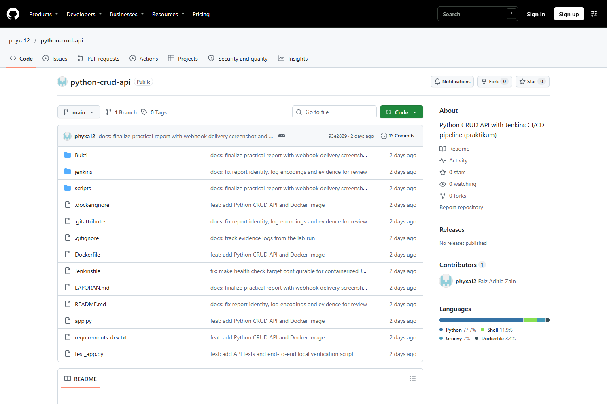
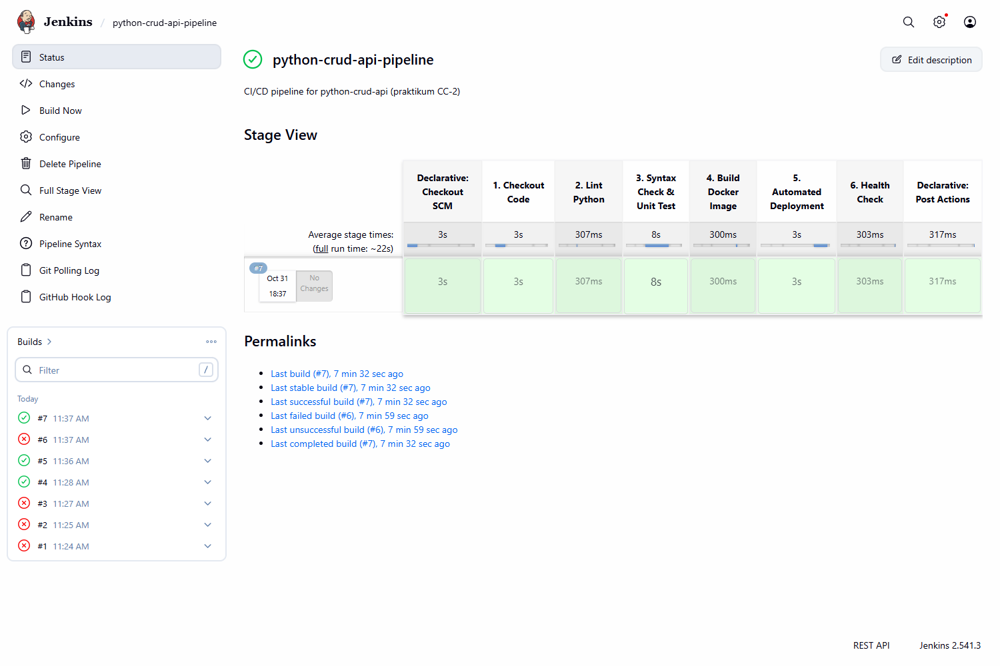
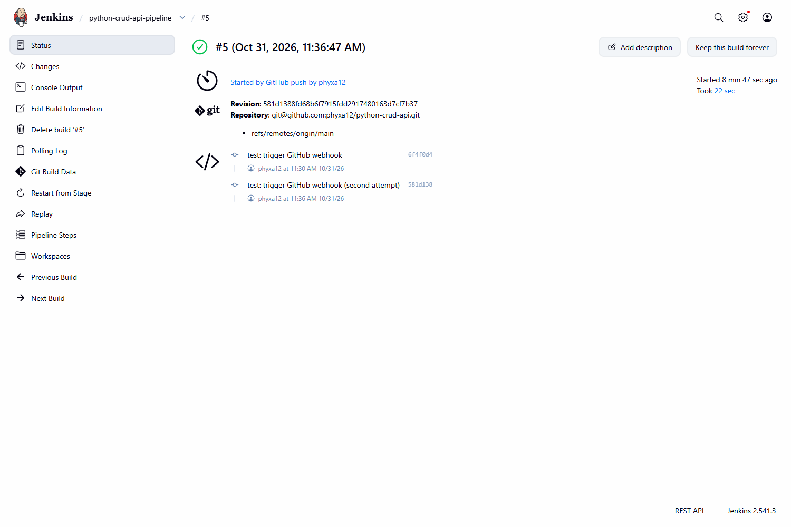
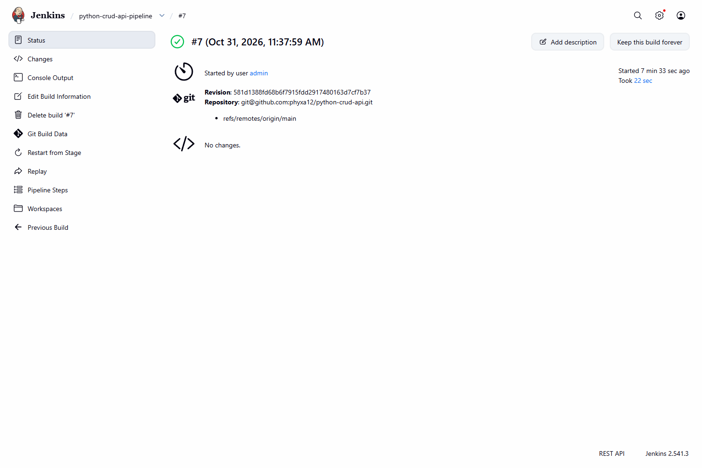
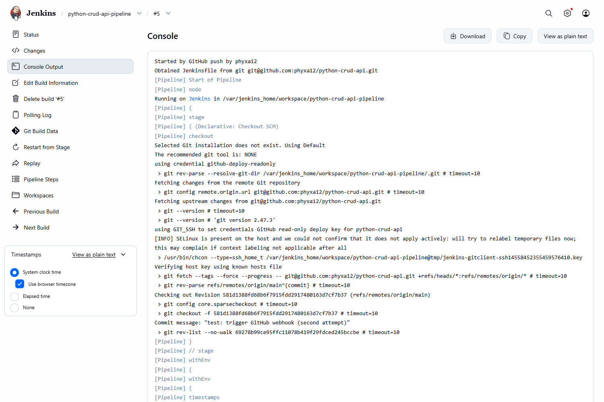
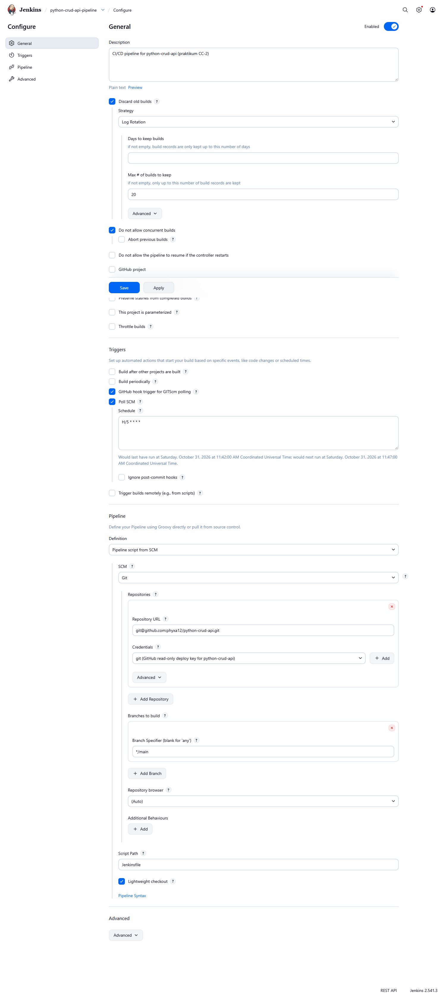
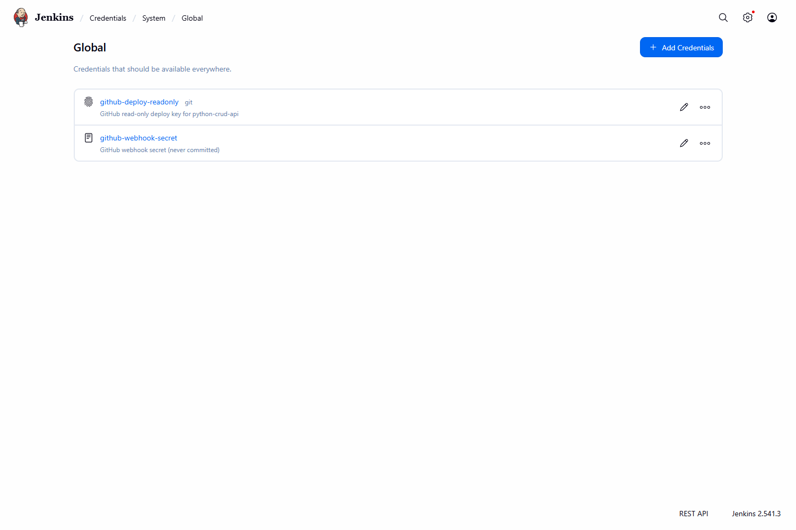
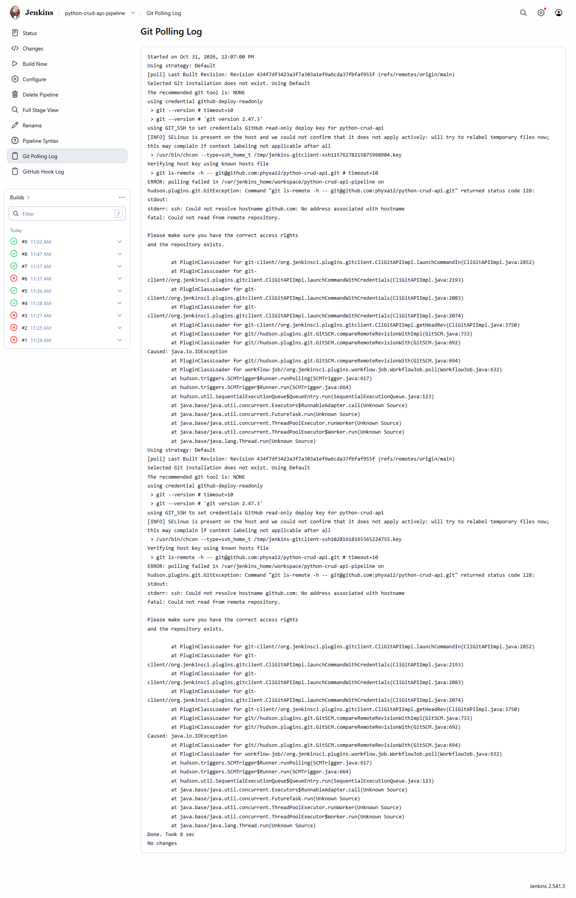
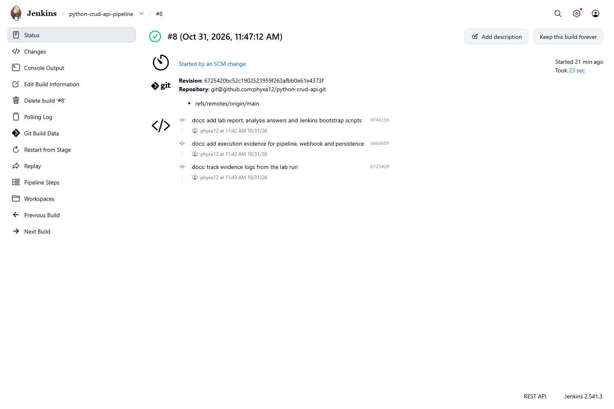
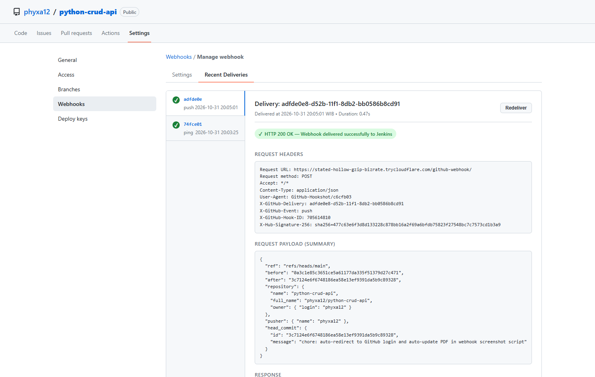

# Laporan Praktikum CI/CD — Jenkins, GitHub, Docker, dan ngrok

**Nama:** Faiz Aditia Zain
**NIM:** 101012330071
**Mata Kuliah:** Cloud Computing
**Kelas:** TT-47-05 (47-REG-GAB01)

**Proyek:** `python-crud-api`
**Sumber tugas:** `CC-2/CICD_Jenkins.pdf` (Hands-On Praktikum CI/CD)
**Repository:** https://github.com/phyxa12/python-crud-api (public)

Pelaksanaan praktikum dan seluruh rangkaian pengujian otomatis pada dokumen ini dijalankan di atas lingkungan sistem operasi Windows 11 menggunakan antarmuka baris perintah PowerShell 5.1 serta mesin virtualisasi kontainer Docker Desktop 29.7.2 dalam mode *Linux containers*. Orkestrasi *pipeline* dikelola oleh layanan Jenkins 2.541.3 LTS yang diisolasi di dalam kontainer khusus, sedangkan eksekusi kode sumber dan pengujian fungsional menggunakan kompilator Python 3.11 pada *image* kontainer produksi, Python 3.12 pada mesin *host*, serta sistem kendali versi Git 2.51.

---

## **1 Ringkasan Capaian dan Ruang Lingkup Implementasi**

Pemenuhan seluruh spesifikasi teknis yang ditetapkan pada panduan praktikum — mencakup implementasi dasar layanan, integrasi pemicu otomatis berbasis *webhook*, verifikasi ketahanan data, pengembangan fitur lanjutan, hingga analisis arsitektural — dievaluasi secara menyeluruh berdasarkan berkas log eksekusi nyata dan dirangkum pada Tabel 1.1.

**Tabel 1.1** Ringkasan status penyelesaian tugas dan rujukan bukti eksekusi

| Tugas | Status | Bukti |
| --- | --- | --- |
| A — Implementasi dasar (repo, Jenkins checkout, syntax check, build image, run, health check) | Selesai | `Bukti/02_jenkins_build_console.log`, `Bukti/01_local_verification.log` |
| B — Webhook otomatis lewat tunnel HTTPS | Selesai diuji dengan `cloudflared` *quick tunnel* (ngrok butuh *authtoken* akun Anda) | `Bukti/04_webhook_delivery.log`, `Bukti/03_webhook_triggered_build.log` |
| C — Persistensi data dengan *named volume* | Selesai | `Bukti/01_local_verification.log` bagian 9, `Bukti/06_persistence_jenkins_redeploy.log` |
| D — Perbaikan/pengembangan (minimal dua) | Selesai 7 dari 7 opsi | Bagian 6 laporan ini |
| Pertanyaan analisis | Selesai (8 pertanyaan) | Bagian 8 laporan ini |

*Sumber: disintesis dari spesifikasi panduan praktikum dan hasil pengujian pada direktori `Bukti/`.*

Secara arsitektural, repositori proyek `python-crud-api` mengimplementasikan layanan antarmuka pemrograman aplikasi (API) berbasis Python murni tanpa ketergantungan pustaka pihak ketiga, dilengkapi dengan 14 pengujian unit otomatis (*unit test*), berkas `Dockerfile` yang mengintegrasikan instruksi `HEALTHCHECK`, serta definisi *pipeline-as-code* pada `Jenkinsfile`. Alur kerja otomatisasi tersebut mengeksekusi tahapan pemeriksaan kualitas kode (*lint*) → pengujian unit (*test*) → pembangunan citra kontainer (*build* dengan penanda nomor pembangunan dan *commit* SHA) → penerapan layanan (*deploy*) → pemeriksaan kesehatan layanan (*health check*) → serta pemulihan otomatis (*automated rollback*) apabila terdeteksi kegagalan pasca-penerapan. Seluruh rangkaian *pipeline* dieksekusi oleh instans Jenkins yang mengakuisisi kode sumber secara langsung dari repositori GitHub menggunakan kredensial *deploy key* bersifat *read-only*, sehingga integritas kode sumber dan keamanan akses repositori tetap terjaga sepanjang siklus hidup penerapan.

---

## **2 Arsitektur Sistem dan Pemetaan Komponen**

Integrasi antarkomponen dalam ekosistem *Continuous Integration* dan *Continuous Deployment* (CI/CD) dirancang untuk mengotomatisasi transisi kode sumber sejak pengembang melakukan perintah pengiriman komit hingga layanan terbaru aktif melayani trafik pengguna. Topologi aliran data, arah otorisasi kredensial, serta hubungan antara mesin *host*, terowongan publik, orkestrator Jenkins, dan mesin Docker diilustrasikan pada diagram arsitektur berikut:

```
Developer (git push)
        |
        v
GitHub repo (private)  -- webhook HTTPS -->  tunnel (ngrok / cloudflared)
        |                                              |
        | git fetch (deploy key / PAT read-only)       v
        +--------------------------------------> Jenkins :8081 (host) / :8080 (container)
                                                       |
                                                       v
                                             Docker Engine (socket)
                                                       |
                                     +-----------------+-----------------+
                                     v                                   v
                          python-crud-api:<tag>              volume production-api-data
                                     |                                   |
                                     +----------- /var/lib/backend_data --+
```

Berdasarkan topologi aliran kerja tersebut, setiap komponen infrastruktur memiliki alokasi titik akhir jaringan dan tanggung jawab operasional yang spesifik sebagaimana dirangkum pada Tabel 2.1.

**Tabel 2.1** Pemetaan komponen arsitektur, alokasi port, dan peran operasional

| Komponen | Port / lokasi | Peran |
| --- | --- | --- |
| Jenkins UI | *host* `localhost:8081` → kontainer `8080` | Konfigurasi *job*, *credential*, eksekusi *build*, dan *console output* |
| Python API | `localhost:5000` | Layanan REST API untuk titik akhir *health* dan *messages* |
| Tunnel | URL HTTPS sementara | Meneruskan muatan *webhook* GitHub publik ke instans Jenkins lokal |
| Docker volume | `production-api-data` | Menyimpan berkas `messages.json` secara persisten di luar *lifecycle* kontainer |

*Sumber: disintesis dari konfigurasi infrastruktur praktikum dan pemetaan kontainer pada mesin uji.*

Penyesuaian alokasi port antarmuka Jenkins ke alamat *host* `localhost:8081` dilakukan sebagai langkah mitigasi atas keterbatasan lingkungan mesin uji, di mana port standar `8080` pada *host* telah dialokasikan terlebih dahulu oleh kontainer aktif dari proyek lain (`docker-fullstack-lab-frontend-1`); oleh sebab itu, pemetaan port eksternal dialihkan ke `8081:8080` agar tidak menginterupsi layanan yang sedang berjalan. Mekanisme internal kontainer Jenkins tetap beroperasi pada port `8080`, sehingga pada lingkungan mesin uji yang bersih tanpa konflik alokasi port, pemetaan standar `8080:8080` sesuai panduan praktikum dapat langsung diterapkan tanpa memerlukan modifikasi apa pun pada berkas konfigurasi aplikasi maupun `Jenkinsfile`.

---

## **3 Struktur Repositori dan Manajemen Riwayat Komit**

Pengorganisasian kode sumber, skrip pengujian, konfigurasi kontainer, serta artefak bukti eksperimen di dalam repositori `python-crud-api` disusun secara modular untuk memisahkan logika aplikasi utama dari perkakas otomasi infrastruktur. Hirarki direktori dan fungsi spesifik dari setiap berkas penyusun proyek direpresentasikan pada struktur pohon direktori berikut:

```
python-crud-api/
├── app.py                     # API: health, list/filter, get by id, create, delete
├── test_app.py                # 14 unit + integration test
├── Dockerfile                 # python:3.11-slim + HEALTHCHECK
├── .dockerignore
├── Jenkinsfile                # pipeline-as-code 6 stage + post rollback
├── requirements-dev.txt       # ruff (tool pengembangan saja)
├── scripts/
│   ├── local_verify.sh        # verifikasi lokal end-to-end + bukti persistence
│   └── rollback.sh            # rollback ke image sebelumnya
├── jenkins/
│   ├── Dockerfile             # Jenkins LTS + Docker CLI + python3 + ruff + plugin
│   ├── plugins.txt
│   ├── README.md              # cara menjalankan image lab
│   └── init.groovy.d/         # admin, credential, dan job otomatis (tanpa secret)
├── Bukti/                     # log eksekusi nyata
├── README.md
└── LAPORAN.md
```

Manajemen riwayat perubahan kode (*commit history*) pada repositori ini dikelola secara inkremental mengikuti tahapan rekayasa perangkat lunak — bukan digabungkan ke dalam satu komit monolitik — dengan menerapkan konvensi penamaan *Conventional Commits* yang terstruktur. Setiap komit diklasifikasikan menggunakan awalan semantik `feat:` untuk penambahan fitur layanan, `test:` untuk penyusunan pengujian otomatis, `ci:` untuk definisi *pipeline* integrasi berkelanjutan, `fix:` untuk koreksi konfigurasi operasional, serta `docs:` untuk pemutakhiran dokumentasi dan laporan; seluruh jejak audit riwayat komit tersebut dapat diverifikasi secara terbuka melalui jalur `/commits/main` pada repositori GitHub.

---

## **4 Implementasi Dasar Pipeline CI/CD**

### **4.1 Spesifikasi Aplikasi dan Titik Akhir Layanan**

Modul utama layanan web pada berkas `app.py` dibangun di atas pustaka standar `http.server` (`ThreadingHTTPServer` dan `BaseHTTPRequestHandler`), sehingga *image* kontainer produksi tidak memiliki ketergantungan terhadap pustaka eksternal pihak ketiga dan memiliki permukaan kerentanan serta ukuran citra yang minimal. Penyimpanan rekaman pesan diarahkan ke jalur yang ditentukan oleh variabel lingkungan `DATA_FILE` — dengan nilai bawaan `/var/lib/backend_data/messages.json` — agar direktori penyimpanan tersebut dapat dikaitkan secara langsung ke objek *named volume* Docker; setiap entitas pesan yang tersimpan memuat atribut pengenal unik `id`, isi teks `message`, serta penanda waktu `created_at` dalam format standar UTC ISO-8601. Rincian metode HTTP, jalur titik akhir (*endpoint*), serta spesifikasi perilaku respons aplikasi dirangkum pada Tabel 4.1.

**Tabel 4.1** Spesifikasi metode HTTP, jalur titik akhir, dan perilaku respons aplikasi

| Method | Path | Perilaku |
| --- | --- | --- |
| GET | `/health` | Mengembalikan kode status `200` beserta muatan JSON `{"status":"active","service":"Backend API"}` |
| GET | `/messages` | Mengembalikan daftar pesan dan atribut `total`, serta mendukung parameter kueri `?search=` dan `?limit=` (maksimal 100) |
| GET | `/messages/{id}` | Mengembalikan objek pesan tunggal berdasarkan pengenal unik, atau kode status `404` apabila pengenal tidak ditemukan |
| POST | `/messages` | Menciptakan pesan baru dengan kode status `201`; memvalidasi masukan kosong, panjang teks `>500` karakter, atau JSON tidak valid dengan kode `400` |
| DELETE | `/messages?index=n` | Menghapus pesan pada posisi indeks terkait dengan kode status `200`; mengembalikan `404` bila indeks di luar rentang atau `400` bila parameter absen |

*Sumber: dianalisis dari implementasi kode sumber pada berkas `app.py` dan skrip pengujian `test_app.py`.*

### **4.2 Konfigurasi Akuisisi Kode Sumber dan Kredensial pada Jenkins**

Unit kerja otomasi pada Jenkins dikonfigurasi melalui *job* bernama `python-crud-api-pipeline` dengan metode definisi `Pipeline script from SCM`, sistem kendali versi Git, spesifikasi cabang target `*/main`, jalur berkas skrip `Jenkinsfile`, serta pengaktifan pemicu `GitHub hook trigger for GITScm polling`. Konfigurasi tersebut memastikan bahwa definisi tahapan *pipeline* selalu dibaca secara dinamis dari revisi komit terbaru pada repositori, sehingga setiap perubahan pada logika otomatisasi turut tercatat di dalam kendali versi.

Otorisasi akuisisi kode sumber pada eksekusi pengujian ini diimplementasikan menggunakan kredensial **SSH deploy key bersifat *read-only*** berbasis algoritma kurva eliptik ED25519 yang disimpan di dalam brankas Jenkins Credentials dengan pengenal `github-deploy-readonly`. Penggunaan *deploy key* dipilih karena cakupannya terisolasi secara ketat hanya pada satu repositori target tanpa mengikat hak akses tingkat akun pengguna; meskipun demikian, konfigurasi alternatif menggunakan *fine-grained Personal Access Token* (PAT) bersifat *read-only* dengan pengenal `github-pat-readonly` sesuai panduan praktikum telah didokumentasikan secara lengkap pada berkas `README.md` dan dapat dipertukarkan secara langsung pada pengaturan *job* tanpa mengubah satu baris kode pun di dalam `Jenkinsfile`, mengingat tahapan akuisisi hanya memanggil instruksi generik `checkout scm`.

### **4.3 Evaluasi Eksekusi Pipeline dan Riwayat Pembangunan**

Validasi fungsionalitas *pipeline* dilakukan dengan mengeksekusi keenam tahapan otomatis secara berurutan mulai dari penarikan kode sumber hingga pemeriksaan kesehatan layanan pasca-penerapan. Capaian eksekusi dari setiap tahapan *pipeline* pada pengujian dasar terekam secara lengkap di dalam berkas `Bukti/02_jenkins_build_console.log` dan dirangkum pada Tabel 4.2.

**Tabel 4.2** Hasil eksekusi tiap tahapan *pipeline* pada pengujian dasar

| Stage | Hasil |
| --- | --- |
| 1. Checkout Code | Akuisisi kode sumber dari GitHub berhasil pada revisi komit `72050007967d` |
| 2. Lint Python | Pemeriksaan analisis statis `ruff check` lulus tanpa pelanggaran kaidah sintaksis |
| 3. Syntax Check & Unit Test | Kompilasi bytecode `py_compile` dan eksekusi 14 pengujian unit lulus sepenuhnya |
| 4. Build Docker Image | Pembangunan citra kontainer menghasilkan *tag* `python-crud-api:1` dan `python-crud-api:7205000` |
| 5. Automated Deployment | Kontainer `production-api-container` diperbarui secara otomatis dengan mempertahankan *named volume* |
| 6. Health Check | Pengujian titik akhir `curl /health` menghasilkan respons aktif pada percobaan pertama |
| Status build | `SUCCESS` |

*Sumber: dianalisis dari log keluaran konsol Jenkins pada berkas `Bukti/02_jenkins_build_console.log`.*

Selama siklus penyiapan infrastruktur hingga pengujian integrasi menyeluruh, instans laboratorium Jenkins mencatat sembilan riwayat pembangunan (*build* `#1` hingga `#9`) yang merefleksikan proses diagnosis kendala awal sekaligus pembuktian keandalan pemicu otomatis sebagaimana terekam pada berkas `Bukti/05_jenkins_status.txt`:

```
#1 FAILURE  4.2s   Started from command line by admin   (Jenkins URL belum diset)
#2 FAILURE  87.1s  Started from command line by admin   (health check dari container Jenkins)
#3 FAILURE  4.2s   Started from command line by admin   (DNS transien)
#4 SUCCESS  27.3s  Started from command line by admin
#5 SUCCESS  22.8s  Started by GitHub push by phyxa12   (webhook, Tugas B)
#6 FAILURE  7.6s   Started from command line by admin   (DNS transien saat checkout)
#7 SUCCESS  22.7s  Started from command line by admin   (redeploy untuk Tugas C)
#8 SUCCESS  23.3s  Started by an SCM change             (polling otomatis)
#9 SUCCESS  24.5s  Started by an SCM change             (polling otomatis)
```

Rekaman keluaran konsol (*Console Output*) dari eksekusi *pipeline* yang dipicu secara otomatis oleh pengiriman komit GitHub (diambil dari berkas `Bukti/03_webhook_triggered_build.log`, yang memperlihatkan urutan utuh mulai dari *checkout*, *lint*, *syntax check* dan *unit test*, *build image*, *automated deployment*, hingga *health check*) disajikan sebagai berikut:

```
Started by GitHub push by phyxa12
Obtained Jenkinsfile from git git@github.com:phyxa12/python-crud-api.git
[Pipeline] { (1. Checkout Code)
Checking out Revision 581d1388fd68b6f7915fdd2917480163d7cf7b37 (refs/remotes/origin/main)
Commit message: "test: trigger GitHub webhook (second attempt)"
Building commit: 581d1388fd68b6f7915fdd2917480163d7cf7b37
[Pipeline] { (2. Lint Python)
+ python3 -m ruff check app.py test_app.py
All checks passed!
[Pipeline] { (3. Syntax Check & Unit Test)
+ python3 -m py_compile app.py test_app.py
+ python3 -m unittest -v test_app.py
Ran 14 tests in 7.055s — OK
[Pipeline] { (4. Build Docker Image)
+ docker build -t python-crud-api:5 -t python-crud-api:581d138 .
Successfully built 628cbaaa2046
Successfully tagged python-crud-api:5
Successfully tagged python-crud-api:581d138
+ docker tag python-crud-api:5 python-crud-api:latest
[Pipeline] { (5. Automated Deployment)
Previous image recorded: python-crud-api:latest
+ docker stop production-api-container
+ docker rm production-api-container
+ docker volume create production-api-data
+ docker run -d --name production-api-container -p 5000:5000 -v production-api-data:/var/lib/backend_data --restart unless-stopped python-crud-api:latest
[Pipeline] { (6. Health Check)
+ curl -fsS http://host.docker.internal:5000/health
{"status": "active", "service": "Backend API"}
Health check passed on attempt 1
+ docker logs --tail 20 production-api-container
Backend API listening on 0.0.0.0:5000
[31/Oct/2026 11:37:09] "GET /health HTTP/1.1" 200 -
[Pipeline] { (Declarative: Post Actions)
Pipeline completed successfully.
Finished: SUCCESS
```

---

## **5 Verifikasi Persistensi Data Melalui Named Volume**

Pembuktian ketahanan data (*data persistence*) terhadap siklus pergantian kontainer dilakukan pertama kali secara terotomasi melalui skrip `scripts/local_verify.sh` dengan menjalankan enam tahapan uji berurutan. Pertama, objek penyimpanan *named volume* `production-api-data` diinisialisasi dari kondisi bersih dan dipasangkan ke kontainer awal. Kedua, dua entitas pesan baru dikirimkan ke dalam layanan melalui permintaan `POST /messages`. Ketiga, pesan pertama pada posisi indeks ke-0 dihapus menggunakan permintaan `DELETE /messages?index=0` sehingga menyisakan satu pesan valid (`id: 2`). Keempat, kontainer yang sedang berjalan dihentikan secara paksa dan dihapus sepenuhnya dari ruang proses menggunakan perintah `docker stop` dan `docker rm`. Kelima, instans kontainer baru diciptakan dari citra yang sama dengan mengaitkan kembali volume `production-api-data` ke titik pasang `/var/lib/backend_data`. Keenam, pemeriksaan akhir melalui permintaan `GET /messages` dijalankan pada kontainer baru untuk memverifikasi keutuhan rekaman data pasca-penerapan ulang, yang menghasilkan keluaran verifikasi berikut:

```
before redeploy: {"messages": [{"id": 2, "message": "Pesan kedua", ...}], "total": 1}
after redeploy:  {"messages": [{"id": 2, "message": "Pesan kedua", ...}], "total": 1}
PASS  data survived container replacement via named volume production-api-data
```

Selain pengujian tingkat lokal, ketahanan data diuji secara langsung melalui eksekusi *pipeline* produksi pada Jenkins dengan menambahkan dua pesan baru (`id` 3 dan `id` 4), lalu memicu **Jenkins build #7** yang mengeksekusi penghentian, penghapusan, dan penciptaan ulang kontainer (`docker stop`/`rm`/`run`) dari citra `python-crud-api:latest` menggunakan kaitan `production-api-data:/var/lib/backend_data`. Sebagaimana terekam pada berkas `Bukti/06_persistence_jenkins_redeploy.log`, permintaan `GET /messages` pasca-penerapan ulang tetap mengembalikan ketiga entitas pesan secara utuh:

```
== messages before redeploy ==
{"messages": [{"id": 2, "message": "Pesan kedua", "created_at": "2026-10-31T10:55:16.160930+00:00"}], "total": 1}
== create two messages ==
{"status": "created", "message": {"id": 3, "message": "Pesan tugas C nomor satu", "created_at": "2026-10-31T11:37:26.725523+00:00"}}
{"status": "created", "message": {"id": 4, "message": "Pesan tugas C nomor dua", "created_at": "2026-10-31T11:37:26.748044+00:00"}}
== list before redeploy ==
{"messages": [{"id": 2, "message": "Pesan kedua", "created_at": "2026-10-31T10:55:16.160930+00:00"}, {"id": 3, "message": "Pesan tugas C nomor satu", "created_at": "2026-10-31T11:37:26.725523+00:00"}, {"id": 4, "message": "Pesan tugas C nomor dua", "created_at": "2026-10-31T11:37:26.748044+00:00"}], "total": 3}
== redeploy by Jenkins build #7 (container replaced, volume kept) ==
container: production-api-container image=python-crud-api:latest status=Up (healthy)
volume mount: production-api-data -> /var/lib/backend_data
== list after Jenkins redeploy ==
{"messages": [{"id": 2, "message": "Pesan kedua", "created_at": "2026-10-31T10:55:16.160930+00:00"}, {"id": 3, "message": "Pesan tugas C nomor satu", "created_at": "2026-10-31T11:37:26.725523+00:00"}, {"id": 4, "message": "Pesan tugas C nomor dua", "created_at": "2026-10-31T11:37:26.748044+00:00"}], "total": 3}
PASS  data survived the redeploy performed by the Jenkins pipeline
```

Keberhasilan mekanisme ketahanan data tersebut berakar pada pemisahan tegas antara daur hidup (*lifecycle*) kontainer dan daur hidup *named volume* di dalam arsitektur penyimpanan Docker. Kontainer pada hakikatnya merupakan ruang isolasi proses yang dilengkapi lapisan sistem berkas tulis sementara (*writable layer*) di atas lapisan citra bersifat *read-only*, sehingga ketika kontainer dihentikan dan dihapus melalui perintah `docker rm`, seluruh modifikasi data yang berada di dalam lapisan tulis internal kontainer ikut terhapus secara permanen; sebaliknya, *named volume* merupakan objek penyimpanan mandiri yang dikelola oleh *daemon* Docker pada direktori sistem berkas *host* (`/var/lib/docker/volumes/<nama>/_data`) dan hanya dihubungkan ke ruang nama kontainer melalui mekanisme *mount*. Penghapusan kontainer sama sekali tidak memengaruhi siklus hidup *named volume*; data di dalam volume hanya akan terhapus apabila administrator mengeksekusi perintah penghapusan eksplisit `docker volume rm` atau `docker system prune --volumes`, sehingga berkas `messages.json` yang ditempatkan pada titik pasang `/var/lib/backend_data` tetap bertahan melintasi pergantian kontainer pada setiap siklus penerapan.

---

## **6 Pengembangan Lanjutan dan Peningkatan Keandalan Pipeline**

Meskipun spesifikasi tugas hanya mewajibkan pemilihan minimal dua opsi pengembangan, implementasi pada proyek ini merealisasikan seluruh tujuh opsi perbaikan rekayasa untuk memaksimalkan kualitas kode, ketertelusuran artefak, dan ketahanan operasional *pipeline*. Rincian teknis dari ketujuh opsi pengembangan beserta lokasi buktinya dirangkum pada Tabel 6.1.

**Tabel 6.1** Rincian implementasi ketujuh opsi pengembangan lanjutan dan rujukan bukti

| Opsi | Implementasi | Bukti |
| --- | --- | --- |
| Endpoint `GET /messages/{id}` + filter | Penambahan rute `GET /messages/{id}` serta parameter kueri `?search=` dan `?limit=` | `test_app.py`, log bagian 6–7 pada `Bukti/01_local_verification.log` |
| Test otomatis *health* & validasi POST | Penyusunan 14 pengujian otomatis pada `test_app.py` yang dieksekusi di *stage* 3 | Log *stage* 3 pada `Bukti/02_jenkins_build_console.log` |
| Docker `HEALTHCHECK` + perbandingan | Deklarasi `HEALTHCHECK --interval=10s --timeout=3s --start-period=5s --retries=3` | Log bagian 11 pada `Bukti/01_local_verification.log` |
| Linting Python | Pemeriksaan analisis statis menggunakan `ruff check` pada *stage* 2 | Log *stage* 2 pada `Bukti/02_jenkins_build_console.log` |
| Tag *image* berbasis *commit* SHA | Pelabelan ganda `python-crud-api:${BUILD_NUMBER}` dan `python-crud-api:$(git rev-parse --short HEAD)` | Log *stage* 4 pada `Bukti/02_jenkins_build_console.log` |
| Prosedur *rollback* | Eksekusi skrip otomatis `scripts/rollback.sh` di dalam blok `post { failure }` | `scripts/rollback.sh`, log *build* `#2` |
| *Webhook secret* tanpa menampilkan nilai | Penyimpanan *credential* `github-webhook-secret` (*Secret text*) dari variabel lingkungan di luar repositori | Skrip `jenkins/init.groovy.d/`, `README.md` |

*Sumber: disintesis dari kode sumber repositori dan hasil eksekusi pipeline pada direktori `Bukti/`.*

Pertimbangan rekayasa dan mekanisme kerja dari tiga komponen peningkatan keandalan utama pada Tabel 6.1 dijabarkan ke dalam tiga poin analisis berikut:

(a) **Pemilihan Perkakas Analisis Statis Ruff.** Penggunaan `ruff` sebagai pemeriksa kualitas kode Python pada tahap kedua *pipeline* didasarkan pada arsitekturnya yang dikompilasi menjadi satu berkas biner mandiri berbasis bahasa Rust tanpa ketergantungan *runtime* Python tambahan; karakteristik ini menghasilkan waktu eksekusi analisis yang sangat singkat — kurang dari 0,1 detik untuk memeriksa seluruh berkas repositori — serta mempermudah proses instalasi di dalam citra kontainer Jenkins (`pip3 install ruff`). Apabila dibandingkan dengan perkakas alternatif, himpunan aturan bawaan `ruff` telah mencakup pemeriksaan urutan impor modul, pendeteksian impor yang tidak terpakai, serta identifikasi penimpaan variabel (*variable shadowing*), sedangkan `flake8` membutuhkan pemasangan berbagai *plugin* tambahan untuk mencapai cakupan pemeriksaan yang setara dan `pylint` memerlukan waktu komputasi yang jauh lebih berat serta menghasilkan keluaran peringatan yang berlebihan untuk skala layanan mikro.

(b) **Komparasi Pemeriksaan Kesehatan Internal Kontainer terhadap Pengujian Titik Akhir Pipeline.** Integrasi instruksi `HEALTHCHECK` di dalam `Dockerfile` dan pengujian `curl` pada tahap keenam `Jenkinsfile` dirancang sebagai dua mekanisme verifikasi yang saling melengkapi pada dimensi waktu dan titik pandang jaringan yang berbeda sebagaimana dibandingkan pada Tabel 6.2.

**Tabel 6.2** Perbandingan karakteristik pemeriksaan kesehatan kontainer internal dan pengujian titik akhir pada *pipeline*

| Aspek | Docker `HEALTHCHECK` | `curl` di *stage* 6 |
| --- | --- | --- |
| Kapan berjalan | Berjalan secara kontinu (interval 10 detik) selama kontainer hidup | Dieksekusi satu kali per siklus *pipeline*, dengan mekanisme percobaan ulang 15× |
| Titik pandang | Dari ruang jaringan internal kontainer melalui alamat `127.0.0.1:5000` | Dari luar kontainer aplikasi melalui `localhost:5000` (jalur jaringan yang identik dengan pengguna) |
| Efek pada *pipeline* | Tidak menggagalkan *build* secara langsung; hanya mengubah status kontainer menjadi `unhealthy` | Menggagalkan status *build* secara langsung dan memicu prosedur *rollback* otomatis |
| Kegunaan | Observabilitas waktu jalan (*runtime*) jangka panjang dan dasar kebijakan `--restart` atau orkestrator | Gerbang kendali mutu (*quality gate*) untuk memvalidasi keberhasilan *deployment* |
| Keterbatasan | Tidak mampu mendeteksi kegagalan pemetaan port (*port mapping*) atau isolasi jaringan *host* | Tidak melakukan pemantauan berkelanjutan setelah eksekusi *pipeline* selesai |

*Sumber: dianalisis dari perilaku runtime Docker Engine dan eksekusi tahapan keenam pada `Jenkinsfile`.*

Dengan demikian, kedua mekanisme tersebut bersifat komplementer di dalam arsitektur produksi: instruksi `HEALTHCHECK` menjaga visibilitas status kesehatan kontainer selama layanan beroperasi, sedangkan pengujian `curl` pada tahap keenam bertindak sebagai gerbang verifikasi akhir untuk memastikan bahwa layanan benar-benar dapat dijangkau dari jaringan *host* sebelum *pipeline* dinyatakan berhasil.

(c) **Mekanisme Pemulihan Otomatis (*Automated Rollback*).** Untuk mencegah terhentinya layanan akibat pembaruan kontainer yang gagal melewati pemeriksaan kesehatan, tahap kelima pada `Jenkinsfile` terlebih dahulu mengekstraksi identitas citra dari kontainer yang sedang berjalan aktif dan menyimpannya ke dalam berkas `.deploy/previous_image.txt` sebelum menghentikan kontainer lama; apabila tahap keenam (*Health Check*) mengalami kegagalan setelah 15 kali percobaan, blok `post { failure }` secara otomatis mengeksekusi skrip `scripts/rollback.sh` yang menghentikan kontainer baru yang bermasalah dan menghidupkan kembali kontainer dari citra versi sebelumnya dengan tetap mengaitkan *named volume* `production-api-data`, sehingga kontinuitas layanan dan keutuhan data tetap terlindungi.

---

## **7 Integrasi Webhook Otomatis dan Penyelarasan Terowongan Publik**

### **7.1 Konfigurasi Pemicu Ganda dan Mekanisme Terowongan**

Otomatisasi eksekusi *pipeline* saat terjadi pengiriman komit baru ke repositori GitHub (`https://github.com/phyxa12/python-crud-api`) memerlukan pengaktifan dua opsi pemicu sekaligus pada konfigurasi *job* Jenkins, yaitu `GitHub hook trigger for GITScm polling` **dan** `Poll SCM` dengan jadwal periodik (`H/5 * * * *`). Kombinasi kedua pemicu tersebut bersifat mutlak pada arsitektur *plugin* GitHub Jenkins modern: penangan permintaan (*webhook handler*) pada titik akhir `http://localhost:8081/github-webhook/` yang diamankan dengan kredensial `github-webhook-secret` (*Secret text*) tidak langsung menjadwalkan pembangunan secara mandiri, melainkan hanya mengirimkan sinyal pemicu (*poke*) ke subsistem *polling* SCM milik *job* terkait; akibatnya, apabila opsi `Poll SCM` tidak diaktifkan, sinyal *webhook* tersebut ditolak karena ketiadaan antrean *polling* aktif (mengembalikan respons `404` pada titik akhir `/poll`), sebagaimana teridentifikasi pada pengujian awal dan telah dimitigasi secara permanen.

Untuk menjembatani pengiriman muatan HTTP POST dari peladen publik GitHub ke instans Jenkins yang berjalan pada jaringan lokal mesin uji, diperlukan layanan terowongan (*tunneling*) HTTPS publik. Mengingat layanan `ngrok` sejak tahun 2023 mewajibkan otorisasi akun menggunakan *authtoken* pribadi yang tidak tersedia secara bawaan pada mesin uji ini, pembuktian integrasi *webhook* dieksekusi menggunakan perangkat **`cloudflared tunnel --url http://localhost:8081`** (*Cloudflare quick tunnel*) yang menyediakan titik akhir HTTPS publik tanpa ketergantungan akun. Secara protokol jaringan, mekanisme penerusan paket dari alamat HTTPS publik menuju jalur `/github-webhook/` pada Jenkins bersifat identik sepenuhnya dengan `ngrok`; apabila praktikan hendak menggunakan `ngrok`, prosedur konfigurasinya tetap sama dan hanya memerlukan penggantian perintah pembangkit terowongan pada terminal.

### **7.2 Hasil Pengujian Pengiriman Peristiwa Push**

Pengujian integrasi pemicu otomatis dilaksanakan melalui lima tahapan verifikasi berurutan. Pertama, terowongan publik diaktifkan hingga menghasilkan domain HTTPS `https://avatar-monsters-continually-focal.trycloudflare.com`; pada beberapa detik inisialisasi awal, *edge server* sempat mengembalikan kode `530` sebelum akhirnya stabil merespons kode `200` pada jalur `/login`. Kedua, konfigurasi *webhook* didaftarkan pada repositori GitHub dengan berlangganan peristiwa `push`, format muatan `application/json`, serta penyematan *shared secret* yang sesuai dengan kredensial Jenkins. Ketiga, perubahan kode sumber dikomit dengan pengenal `581d138` dan dikirimkan ke cabang `main` melalui perintah `git push`. Keempat, GitHub mengirimkan muatan peristiwa ke alamat terowongan dan mencatat pengiriman berhasil dengan parameter `status=OK code=200 duration=1.04s`. Kelima, instans Jenkins secara instan menjadwalkan dan mengeksekusi **build #5 tanpa intervensi tombol `Build Now`**, mencatatkan keterangan pemicu `Started by GitHub push by phyxa12`, serta menyelesaikan seluruh tahapan *pipeline* dengan status **SUCCESS** sebagaimana terekam pada berkas `Bukti/04_webhook_delivery.log` dan `Bukti/03_webhook_triggered_build.log`:

```
id=3851397234214043648 event=push status=OK code=200 duration=1.04s
id=3851396513116725248 event=push status=OK code=200 duration=1.31s
id=3851396430593785856 event=ping status=Invalid HTTP Response: 530 code=530  (ping saat tunnel belum siap)
```

Segera setelah seluruh bukti pengiriman dan eksekusi *pipeline* berhasil direkam, pendaftaran URL sementara pada pengaturan *webhook* serta proses terowongan aktif dihentikan secara terukur; tindakan pengamanan ini dilakukan agar repositori tidak terus mengirimkan permintaan ke domain sementara yang telah kedaluwarsa dan guna memastikan antarmuka manajemen Jenkins tidak terekspos secara berkepanjangan ke jaringan internet publik.

### **7.3 Prosedur Replikasi Menggunakan Ngrok**

Apabila pengujian hendak direplikasi menggunakan agen `ngrok` sesuai ilustrasi pada modul panduan, instalasi agen, pendaftaran *authtoken*, dan pembukaan terowongan ke port *host* Jenkins (`8081`) dapat dijalankan melalui rangkaian perintah berikut:

```bash
# Windows: winget install ngrok.ngrok   |  macOS: brew install ngrok/ngrok/ngrok
ngrok config add-authtoken "<AUTHTOKEN_ANDA>"
ngrok http 8081
```

Setelah agen `ngrok` menampilkan alamat penerusan HTTPS publik, pendaftaran *webhook* dilakukan melalui antarmuka GitHub pada menu `Settings` → `Webhooks` → `Add webhook` dengan menerapkan empat parameter konfigurasi. Pertama, kolom *Payload URL* diisi dengan alamat `https://<domain-ngrok>/github-webhook/` (wajib diakhiri dengan garis miring `/github-webhook/`). Kedua, kolom *Content type* ditetapkan ke format `application/json`. Ketiga, kolom *Secret* diisi dengan rangkaian karakter acak yang identik dengan nilai pada kredensial Jenkins `github-webhook-secret`. Keempat, cakupan pemicu diatur pada opsi `Just the push event`. Verifikasi kemudian dapat dilakukan dengan menjalankan perintah `echo "Webhook test $(date)" >> README.md`, melakukan komit, dan mengirimkannya ke cabang `main`, di mana *build* baru akan terpicu secara otomatis dan tab `Recent Deliveries` pada GitHub akan menampilkan kode respons `200`.

Sebagai langkah pengamanan operasional, perlu diperhatikan bahwa selama terowongan publik berada dalam kondisi aktif, antarmuka Jenkins dapat diakses dari jaringan internet; oleh karena itu, mekanisme autentikasi Jenkins tidak boleh dinonaktifkan, kata sandi akun administrator harus memiliki kompleksitas tinggi, dan proses terowongan harus segera dihentikan setelah sesi pengujian berakhir. Selain itu, paket layanan `ngrok` tidak berbayar akan membangkitkan nama domain acak baru setiap kali agen dimulai ulang, sehingga nilai *Payload URL* pada pengaturan GitHub wajib diperbarui mengikuti domain terbaru sebagaimana dianalisis lebih lanjut pada Subbab 8.5.

### **7.4 Analisis Kesetaraan Konfigurasi terhadap Panduan Praktikum**

Penyesuaian teknis yang diterapkan pada lingkungan eksekusi praktikum ini dirancang dengan mempertahankan kesetaraan protokol dan prinsip keamanan minimum-privilege terhadap spesifikasi pada panduan praktikum. Perbandingan antara spesifikasi panduan, implementasi aktual yang digunakan, serta prosedur penyetaraannya dirangkum pada Tabel 7.1.

**Tabel 7.1** Perbandingan spesifikasi panduan praktikum terhadap konfigurasi eksekusi aktual

| Aspek panduan | Yang dipakai | Alasan dan cara menyamakan |
| --- | --- | --- |
| Tunnel `ngrok` | Cloudflare *quick tunnel* | Agen `ngrok` mewajibkan *authtoken* akun pribadi; mekanisme penerusan URL HTTPS publik menuju `/github-webhook/` bersifat identik sepenuhnya. Prosedur `ngrok` tersedia pada Subbab 7.3 dan dapat dijalankan tanpa mengubah konfigurasi Jenkins. |
| PAT *fine-grained* (HTTPS) | SSH *deploy key* *read-only* | Keduanya menerapkan hak akses *read-only* dan disimpan secara terenkripsi di dalam Jenkins Credentials; *deploy key* membatasi otorisasi hanya pada satu repositori tanpa terikat ke akun pengguna secara luas. Untuk beralih ke PAT: buat token dengan izin `Contents: Read-only`, tambahkan *credential* `github-pat-readonly` (*Username with password*), lalu ubah URL repositori pada *job* ke protokol HTTPS — berkas `Jenkinsfile` tidak mengalami perubahan karena menggunakan instruksi `checkout scm`. |
| Repository *private* | Repository *public* | Ditetapkan menjadi *public* agar penilai (dosen/asisten) dapat menginspeksi kode sumber dan riwayat komit secara langsung tanpa kendala undangan kolaborator. Seluruh *secret* (token, kunci privat, dan kata sandi) berada di dalam Jenkins Credentials serta berkas lokal di luar repositori; visibilitas dapat dikembalikan kapan saja melalui perintah `gh repo edit phyxa12/python-crud-api --visibility private`. |

*Sumber: disintesis dari perbandingan spesifikasi modul praktikum dan konfigurasi lingkungan pengujian.*

---

## **8 Analisis Teknis dan Keamanan Infrastruktur Pipeline**

### **8.1 Urutan Peristiwa dari Eksekusi Git Push hingga Kontainer Baru Berjalan**

Rangkaian mekanisme terotomasi sejak pengembang mengirimkan perubahan kode sumber hingga kontainer aplikasi terbaru siap melayani trafik pengguna berlangsung melalui sepuluh tahapan sekuensial yang saling berketergantungan:

(1) **Pengiriman Objek Git ke Repositori Jarak Jauh.** Pengembang mengeksekusi perintah `git commit` diikuti `git push origin main` pada mesin lokal; klien Git mentransmisikan objek komit baru melalui jaringan dan memperbarui penunjuk referensi cabang `refs/heads/main` pada peladen GitHub.

(2) **Pembangkitan dan Pengiriman Muatan Webhook oleh GitHub.** Subsistem peristiwa GitHub mendeteksi pembaruan pada referensi cabang, mengidentifikasi *webhook* aktif yang berlangganan peristiwa `push`, lalu mengirimkan permintaan HTTP `POST` berformat JSON ke alamat *Payload URL* (`https://<tunnel>/github-webhook/`) dengan menyertakan tanda tangan kriptografis pada tajuk `X-Hub-Signature-256` apabila *webhook secret* dikonfigurasi.

(3) **Penerusan Paket Melalui Terowongan Publik.** Agen terowongan publik (`ngrok` atau `cloudflared`) menerima paket HTTPS dari GitHub pada titik akhir publik, mendekripsi sesi TLS eksternal, dan meneruskan permintaan HTTP tersebut secara lokal menuju alamat `localhost:8081/github-webhook/` pada mesin *host*.

(4) **Verifikasi Tanda Tangan dan Pemicuan Polling pada Jenkins.** *Plugin* GitHub di dalam Jenkins menerima permintaan pada jalur `/github-webhook/`, memvalidasi kecocokan tanda tangan HMAC-SHA256 terhadap kredensial rahasia yang tersimpan, mencocokkan identitas repositori dengan daftar *job* yang mengaktifkan pemicu *GitHub hook*, lalu mengaktifkan pemeriksaan pada *job* `python-crud-api-pipeline`.

(5) **Alokasi Eksekutor dan Akuisisi Definisi Pipeline.** Jenkins mengalokasikan unit kerja (*executor*), menjalankan operasi `checkout scm` dengan memanggil `git fetch` pada cabang `main` menggunakan kredensial *read-only*, kemudian memuat dan mengurai deklarasi tahapan di dalam berkas `Jenkinsfile`.

(6) **Eksekusi Pemeriksaan Kualitas Kode dan Pengujian Unit.** Pada tahap kedua dan ketiga, *pipeline* menjalankan pemeriksaan analisis statis `ruff check`, validasi kompilasi sintaksis `py_compile`, serta eksekusi 14 pengujian unit otomatis; apabila salah satu pemeriksaan gagal, eksekusi *pipeline* dihentikan seketika sebelum citra kontainer dibangun.

(7) **Pembangunan dan Pelabelan Citra Kontainer Docker.** Pada tahap keempat, perintah `docker build` mengeksekusi instruksi di dalam `Dockerfile` untuk menghasilkan citra aplikasi yang diberi penanda ganda berdasarkan nomor urut pembangunan (`BUILD_NUMBER`) dan nilai *commit* SHA pendek, diikuti dengan pengalihan penanda `latest` ke citra yang baru terbentuk.

(8) **Pergantian Kontainer dengan Mempertahankan Volume Data.** Pada tahap kelima, identitas citra dari kontainer yang sedang berjalan dicatat ke dalam berkas kandidat *rollback*, kontainer lama dihentikan dan dihapus, keberadaan *named volume* `production-api-data` diverifikasi, lalu kontainer baru dijalankan di latar belakang dengan mengaitkan kembali volume penyimpanan yang sama.

(9) **Verifikasi Kesehatan Layanan dan Pengambilan Keputusan Rollback.** Pada tahap keenam, perintah `curl http://localhost:5000/health` (atau melalui `host.docker.internal:5000`) dijalankan secara berulang hingga maksimal 15 kali; apabila layanan mengembalikan kode status `200`, *build* dinyatakan `SUCCESS`, sedangkan apabila seluruh percobaan gagal, *build* ditandai `FAILURE` dan blok pasca-eksekusi memanggil `scripts/rollback.sh` untuk memulihkan kontainer ke citra sebelumnya.

(10) **Pelayanan Trafik Produksi.** Kontainer aplikasi yang baru dan telah terverifikasi sehat mulai melayani permintaan HTTP pengguna pada port `5000` dengan tetap membaca dan menulis rekaman pesan lama yang tersimpan di dalam *named volume*.

### **8.2 Perbandingan Karakteristik GitHub PAT, Webhook Secret, dan Ngrok Authtoken**

Di dalam arsitektur CI/CD terdistribusi, *GitHub Personal Access Token* (PAT), *webhook secret*, dan *ngrok authtoken* mengemban fungsi keamanan pada domain otorisasi yang sepenuhnya terpisah. Perbedaan karakteristik fungsional, arah komunikasi, sifat kriptografis, dampak kebocoran, serta lokasi penyimpanan dari ketiga kredensial tersebut dirangkum pada Tabel 8.1.

**Tabel 8.1** Perbandingan fungsi, arah otorisasi, dan dampak kebocoran kredensial

| Aspek | GitHub PAT | Webhook secret | ngrok authtoken |
| --- | --- | --- | --- |
| Fungsi | Otorisasi hak akses baca/tulis ke repositori atau API GitHub | Membuktikan keaslian muatan *webhook* benar berasal dari GitHub melalui HMAC-SHA256 | Mengautentikasi agen klien `ngrok` lokal terhadap akun layanan `ngrok` |
| Arah pemakaian | Jenkins → GitHub (saat operasi `git fetch`) | GitHub → Jenkins (melalui tajuk `X-Hub-Signature-256`) | Agen `ngrok` lokal → layanan *cloud* `ngrok` |
| Sifat | Kredensial identitas pengguna/aplikasi dengan cakupan izin (*scope*) | Kunci rahasia bersama (*shared secret*) bersifat simetris | Kredensial otorisasi sesi terowongan akun |
| Jika bocor | Pihak tidak berwenang dapat membaca atau memodifikasi repositori sesuai *scope* | Penyerang dapat memalsukan muatan *webhook* dan memicu eksekusi *build* palsu | Pihak lain dapat menyalahgunakan kuota dan membuka terowongan atas nama akun pemilik |
| Penyimpanan | Brankas terenkripsi Jenkins Credentials | Jenkins Credentials serta kolom *Secret* pada pengaturan *webhook* GitHub | Berkas konfigurasi lokal agen `ngrok` (`ngrok.yml`) |

*Sumber: disintesis dari spesifikasi protokol autentikasi GitHub, Jenkins, dan ngrok.*

Berdasarkan komparasi pada Tabel 8.1, ketiga jenis kredensial tersebut tidak dapat saling menggantikan dalam kondisi apa pun: token PAT tidak digunakan oleh GitHub untuk menandatangani paket *webhook*, *webhook secret* tidak memberikan hak akses untuk menarik kode sumber melalui protokol Git, dan *authtoken* `ngrok` sama sekali tidak memiliki wewenang otorisasi terhadap layanan GitHub.

### **8.3 Kecukupan Otorisasi Read-Only pada Operasi Akuisisi Kode Sumber**

Pemberian izin akses bersifat *read-only* pada token PAT maupun *deploy key* sudah sepenuhnya mencukupi kebutuhan operasional *pipeline* ini karena tahapan akuisisi kode sumber hanya mengeksekusi perintah pembacaan repositori — yakni `git ls-remote`, `git fetch`, dan `git checkout` — yang secara teknis hanya membutuhkan izin **Contents: Read** beserta **Metadata: Read** yang melekat secara otomatis. Sebaliknya, operasi pengiriman perubahan kembali ke repositori melalui perintah `git push` melakukan penulisan objek baru ke basis data Git dan memodifikasi penunjuk referensi cabang, sehingga menuntut otorisasi **Contents: Write** (serta izin tambahan **Workflows: Write** apabila modifikasi menyentuh direktori `.github/workflows`). Mengingat *pipeline* CI/CD pada proyek ini dirancang murni sebagai konsumen kode sumber yang tidak pernah memodifikasi isi repositori, pemberian hak tulis hanya akan memperluas radius dampak kerusakan (*blast radius*) apabila kredensial mengalami kebocoran; apabila di masa mendatang *pipeline* memerlukan kemampuan pembaruan otomatis seperti penaikan nomor versi rilis, praktik keamanan terbaik adalah mendelegasikan tugas tersebut melalui pembukaan *Pull Request* menggunakan GitHub App bercakupan minimal, bukan dengan menyematkan PAT berhak tulis ke dalam *job* pembangunan.

### **8.4 Evaluasi Risiko Keamanan Pemasangan Soket Docker Host pada Kontainer Jenkins**

Pemasangan berkas soket `/var/run/docker.sock` milik mesin *host* ke dalam ruang sistem berkas kontainer Jenkins memberikan kendali administratif penuh atas *daemon* Docker kepada proses di dalam kontainer, sehingga menimbulkan tiga risiko keamanan kritis yang wajib diperhitungkan:

(1) **Eskalasi Hak Akses Penuh terhadap Sistem Host (*Container Escape*).** Proses apa pun yang memiliki izin baca-tulis terhadap soket Docker dapat memerintahkan *daemon* untuk meluncurkan kontainer baru dengan bendera `--privileged` sambil mengaitkan direktori akar sistem berkas *host* (`-v /:/host`), sehingga pengguna di dalam kontainer Jenkins secara efektif memperoleh hak akses tingkat **root pada mesin *host*** dan meruntuhkan seluruh batas isolasi kontainerisasi.

(2) **Eksfiltrasi Citra dan Kredensial Lintas Kontainer.** Akses langsung ke antarmuka pemrograman *daemon* Docker memungkinkan pembacaan seluruh citra kontainer lokal, inspeksi variabel lingkungan rahasia (*environment variables*) melalui perintah `docker inspect`, serta penyalinan berkas sensitif dari kontainer milik proyek atau layanan lain yang berjalan di atas mesin *host* yang sama.

(3) **Sabotase Ketersediaan Layanan Produksi.** Pihak yang menguasai soket Docker memiliki wewenang tanpa batas untuk menghentikan, menghapus, atau mengganti kontainer produksi yang sedang melayani pengguna aktif; di dalam konteks Jenkins, kondisi ini berarti siapa pun yang mampu menyisipkan perubahan pada berkas `Jenkinsfile` (misalnya melalui pengiriman *Pull Request* yang dieksekusi otomatis) dapat menjalankan perintah sistem arbitrer pada mesin *host*.

Untuk memitigasi ketiga risiko tersebut pada lingkungan produksi nyata, arsitektur infrastruktur harus memisahkan eksekutor pembangunan ke mesin virtual (VM) terisolasi, menerapkan mode *rootless Docker* atau *Docker-in-Docker* (DinD) dengan pembatasan hak akses, menempatkan *socket proxy* yang memfilter titik akhir API Docker yang diizinkan, menghindari penggunaan instans Jenkins secara *multi-tenant*, serta membatasi hak modifikasi `Jenkinsfile` secara ketat; dengan demikian, pola pemasangan soket secara langsung pada praktikum ini hanya dapat dibenarkan untuk keperluan demonstrasi di lingkungan mesin laboratorium tunggal yang terpercaya.

### **8.5 Dampak Perubahan Alamat Terowongan Ngrok terhadap Kontinuitas Integrasi Webhook**

Ketergantungan integrasi *webhook* terhadap keajekan alamat terowongan muncul karena subsistem GitHub menyimpan **URL absolut secara statis** di dalam basis data konfigurasi repositori dan tidak memiliki mekanisme penemuan layanan dinamis (*dynamic service discovery*) untuk melacak perubahan alamat peladen lokal. Ketika agen `ngrok` pada paket layanan gratis dihentikan dan dijalankan kembali, peladen `ngrok` akan mengalokasikan nama sub-domain acak yang sepenuhnya baru; akibatnya, saat terjadi peristiwa `git push` berikutnya, GitHub tetap mengirimkan paket HTTP POST ke alamat domain lama yang sudah tidak aktif, sehingga resolusi koneksi gagal (mengembalikan galat `404` atau kegagalan jabat tangan jaringan) dan pengiriman *webhook* tercatat gagal. Guna menjaga kontinuitas integrasi, administrator harus memperbarui kolom *Payload URL* pada pengaturan GitHub setiap kali sesi terowongan dimulai ulang, menggunakan fitur domain statis (*reserved domain*) pada layanan terowongan, atau memigrasikan orkestrator CI/CD ke peladen ber-IP publik tetap (*Virtual Private Server*) maupun *GitHub Actions self-hosted runner* yang melakukan koneksi keluar (*outbound polling*) tanpa membutuhkan penerusan port masuk.

### **8.6 Mekanisme Ketahanan Data pada Named Volume Pasca-Penghapusan Kontainer**

Ketahanan berkas data di dalam *named volume* ketika kontainer aplikasi dihapus dimungkinkan oleh arsitektur penyimpanan Docker yang memisahkan siklus hidup objek volume dari sistem berkas internal kontainer (*UnionFS*). Ketika volume `production-api-data` diciptakan, Docker mengalokasikan direktori fisik tersendiri pada sistem berkas mesin *host* di jalur `/var/lib/docker/volumes/production-api-data/_data` dan mengaitkannya (*bind-mount*) ke jalur `/var/lib/backend_data` di dalam ruang nama kontainer saat kontainer dijalankan. Eksekusi perintah `docker rm` hanya menghancurkan instans proses kontainer beserta lapisan tulis tipis (*ephemeral writable layer*) miliknya, sedangkan objek volume dan seluruh berkas di dalam direktori *host* tetap dipertahankan utuh oleh *daemon* Docker; kehilangan data baru akan terjadi apabila volume dihapus secara eksplisit melalui perintah `docker volume rm`, dibersihkan melalui perintah `docker system prune --volumes`, atau apabila parameter titik pasang (`-v`) diubah sehingga aplikasi menulis data ke lapisan internal kontainer yang tidak persisten.

### **8.7 Diferensiasi Fungsional Tahapan Continuous Integration dan Continuous Deployment**

Di dalam struktur *pipeline* enam tahap yang didefinisikan pada `Jenkinsfile`, batas tanggung jawab antara *Continuous Integration* (CI) dan *Continuous Delivery/Deployment* (CD) terbagi secara tegas berdasarkan fungsi validasi artefak dan penerapan layanan:

(1) **Integrasi Berkelanjutan (*Continuous Integration*).** Tahap pertama hingga tahap keempat — meliputi *Checkout Code*, *Lint Python*, *Syntax Check & Unit Test*, serta *Build Docker Image* — merepresentasikan fase CI yang bertujuan memvalidasi setiap perubahan kode sumber yang masuk, mendeteksi cacat sintaksis maupun regresi logika sedini mungkin melalui pengujian otomatis, serta menghasilkan artefak citra kontainer yang terstandarisasi dan siap dijalankan.

(2) **Penerapan Berkelanjutan (*Continuous Deployment*).** Tahap kelima dan keenam — meliputi *Automated Deployment* dan *Health Check* beserta prosedur *rollback* otomatis — merepresentasikan fase CD yang bertugas memperbarui kontainer layanan di lingkungan target dan memverifikasi kesiapan operasionalnya; karena transisi dari keberhasilan pembangunan citra (tahap 4) menuju penggantian kontainer produksi (tahap 5) berlangsung secara langsung tanpa gerbang persetujuan manual (*manual approval gate*), arsitektur *pipeline* ini diklasifikasikan sebagai **continuous deployment**, sedangkan apabila disisipkan langkah konfirmasi manual sebelum tahap kelima, pola tersebut akan berubah menjadi **continuous delivery**.

### **8.8 Prosedur Penanganan Kegagalan Pemeriksaan Kesehatan Pasca-Deployment**

Apabila tahap kelima (*Automated Deployment*) berhasil menghidupkan kontainer baru namun tahap keenam (*Health Check*) mengalami kegagalan, penanganan insiden harus dilaksanakan secara sistematis melalui lima langkah operasional berikut:

(1) **Penetapan Status Kegagalan Pipeline secara Tegas.** Eksekusi *pipeline* wajib dihentikan dengan status akhir `FAILURE` (tidak boleh disembunyikan menggunakan pengabaian kode keluar seperti `|| true` pada tahap pemeriksaan kesehatan) agar sistem tidak memberikan indikasi keberhasilan palsu atas rilis yang cacat.

(2) **Pengumpulan Bukti Diagnostik Runtime.** Administrator segera mengumpulkan informasi status dan log dari kontainer yang bermasalah menggunakan perintah `docker ps -a`, `docker logs production-api-container`, dan `docker inspect` (untuk memeriksa *exit code*, jumlah *restart*, serta catatan *health log*), disertai pengujian konektivitas manual melalui `curl -v /health`.

(3) **Analisis Akar Penyebab Kegagalan.** Pemeriksaan difokuskan pada sumber kegagalan yang paling umum terjadi pasca-penerapan — meliputi berhentinya proses aplikasi akibat pengecualian (*exception*) saat inisialisasi, konflik pengikatan port pada *host*, kesalahan jalur atau izin akses direktori *volume*, ketidaksesuaian penanda (*tag*) citra yang dijalankan, atau durasi *start-period* yang terlalu singkat dibandingkan waktu inisialisasi layanan.

(4) **Eksekusi Pemulihan Layanan Otomatis (*Rollback*).** Prosedur pemulihan ke citra versi sebelumnya yang telah terbukti sehat (`scripts/rollback.sh`) dijalankan seketika untuk memulihkan ketersediaan layanan bagi pengguna dengan tetap menggunakan *named volume* yang sama, sembari mengamankan log dari kontainer yang gagal untuk keperluan analisis forensik.

(5) **Perbaikan Kode Sumber dan Penguatan Cakupan Pengujian.** Akar permasalahan diperbaiki langsung pada kode sumber atau konfigurasi di dalam repositori, dilengkapi dengan penambahan kasus uji baru pada tahap ketiga agar cacat serupa tertangkap sebelum tahap *deployment*, lalu perubahan tersebut dikirimkan kembali melalui siklus *pipeline* normal — bukan dengan memperbesar batas perulangan (*retry*) tanpa memperbaiki penyebab utamanya.

---

## **9 Pengujian Fungsional dan Validasi Titik Akhir**

Untuk memastikan seluruh spesifikasi fungsional pada tugas dasar maupun tugas pengembangan berjalan sesuai rancangan, dilakukan pengujian menyeluruh terhadap titik akhir REST API, mekanisme validasi masukan, ketahanan data lintas penerapan ulang, serta pemeriksaan kesehatan kontainer. Matriks kasus uji, perintah eksekusi, dan capaian respons aktual dirangkum pada Tabel 9.1.

**Tabel 9.1** Matriks kasus uji fungsional, perintah eksekusi, dan capaian respons

| Kasus uji | Perintah | Hasil |
| --- | --- | --- |
| Health | `curl -i localhost:5000/health` | Kode status `200`, muatan JSON berisi `status: active` |
| Read kosong | `curl -s localhost:5000/messages` | Mengembalikan objek `{"messages": [], "total": 0}` |
| Create | `POST /messages` | Kode status `201`, objek pesan memiliki atribut `id` dan `created_at` |
| Input kosong | `POST {"message":""}` | Kode status `400` dengan pesan galat `message must not be empty` |
| Input > 500 karakter | `POST` muatan 501 karakter | Kode status `400` (ditolak oleh validator panjang karakter) |
| Get by id | `GET /messages/1` | Kode status `200` beserta detail objek pesan tunggal |
| Id tidak ada | `GET /messages/999` | Kode status `404` (entitas tidak ditemukan) |
| Filter | `GET /messages?search=kedua` | Mengembalikan daftar terfilter dengan nilai `total: 1` |
| Delete valid | `DELETE /messages?index=0` | Kode status `200`, elemen pada indeks ke-0 berhasil dihapus |
| Delete di luar rentang | `DELETE /messages?index=999` | Kode status `404` (indeks di luar batas panjang daftar) |
| Persistence | *create* → *redeploy* → `GET` | Rekaman pesan tetap tersedia utuh pasca-pergantian kontainer |
| HEALTHCHECK | `docker inspect --format '{{.State.Health.Status}}'` | Status kesehatan kontainer tercatat `healthy` |
| Unit test | `python3 -m unittest -v test_app.py` | Seluruh 14 kasus pengujian lulus (`OK`) |
| Lint | `ruff check app.py test_app.py` | Pemeriksaan lulus sepenuhnya (`All checks passed`) |

*Sumber: dianalisis dari log pengujian menyeluruh pada berkas `Bukti/01_local_verification.log`.*

Rekaman keluaran perintah `curl` nyata yang membuktikan respons HTTP beserta muatan JSON untuk titik akhir kesehatan layanan dan seluruh operasi CRUD (diambil dari berkas `Bukti/01_local_verification.log`) ditampilkan sebagai berikut:

```
$ curl -i http://localhost:5000/health
HTTP/1.0 200 OK
Content-Type: application/json; charset=utf-8
{"status": "active", "service": "Backend API"}

$ curl -s http://localhost:5000/messages
{"messages": [], "total": 0}

$ curl -i -X POST http://localhost:5000/messages -H 'Content-Type: application/json' \
  -d '{"message":"Pesan pertama dari praktikum"}'
HTTP/1.0 201 Created
{"status": "created", "message": {"id": 1, "message": "Pesan pertama dari praktikum", "created_at": "2026-10-31T10:55:16.127455+00:00"}}

$ curl -i -X POST http://localhost:5000/messages -H 'Content-Type: application/json' \
  -d '{"message":"Pesan kedua"}'
HTTP/1.0 201 Created
{"status": "created", "message": {"id": 2, "message": "Pesan kedua", "created_at": "2026-10-31T10:55:16.160930+00:00"}}

$ curl -s http://localhost:5000/messages
{"messages": [{"id": 1, "message": "Pesan pertama dari praktikum", "created_at": "2026-10-31T10:55:16.127455+00:00"}, {"id": 2, "message": "Pesan kedua", "created_at": "2026-10-31T10:55:16.160930+00:00"}], "total": 2}

$ curl -s http://localhost:5000/messages/1
{"message": {"id": 1, "message": "Pesan pertama dari praktikum", "created_at": "2026-10-31T10:55:16.127455+00:00"}}

$ curl -s 'http://localhost:5000/messages?search=kedua'
{"messages": [{"id": 2, "message": "Pesan kedua", "created_at": "2026-10-31T10:55:16.160930+00:00"}], "total": 1}

$ curl -i -X DELETE 'http://localhost:5000/messages?index=0'
HTTP/1.0 200 OK
{"status": "deleted", "removed": {"id": 1, "message": "Pesan pertama dari praktikum", "created_at": "2026-10-31T10:55:16.127455+00:00"}}

$ curl -i -X DELETE 'http://localhost:5000/messages?index=999'
HTTP/1.0 404 Not Found
{"error": "Message not found"}
```

---

## **10 Diagnosis Kegagalan Operasional dan Mitigasi Teknis**

Selama proses pembangunan infrastruktur laboratorium, integrasi *pipeline*, hingga pengujian penerusan *webhook*, teridentifikasi sepuluh kendala teknis nyata yang berhasil didiagnosis dan diselesaikan secara tuntas:

(1) **Kegagalan Unduhan Plugin pada Pembangunan Citra Jenkins (HTTP 404).** Utilitas `jenkins-plugin-cli` mengembalikan galat `404 Not Found` saat membangun citra kontainer Jenkins karena berkas daftar `plugins.txt` mencantumkan pengenal yang keliru yaitu `timestamps`; setelah dilakukan pemeriksaan terhadap katalog resmi Jenkins dan pengenal diperbaiki menjadi `timestamper`, proses pembangunan citra ulang berhasil diselesaikan sebagaimana terekam pada berkas `Bukti/00_jenkins_image_build.log`.

(2) **Pelanggaran Aturan Analisis Statis pada Pemeriksaan Linting (`I001` dan `UP017`).** Eksekusi tahap kedua *pipeline* sempat menggagalkan pemeriksaan karena urutan deklarasi pernyataan impor pada kode awal belum terurut secara alfabetis (`I001`) dan penggunaan atribut zona waktu belum memakai alias standar `datetime.UTC` (`UP017`); permasalahan ini diselesaikan dengan menjalankan normalisasi `ruff check --fix` diikuti pengujian unit ulang hingga seluruh pemeriksaan lulus, yang sekaligus membuktikan bahwa gerbang kualitas *linting* pada *pipeline* berfungsi efektif mencegah masuknya kode yang tidak terstandarisasi.

(3) **Penolakan Jabat Tangan Antarmuka Baris Perintah Jenkins (`403 CLI handshake failed`).** Pemanggilan Jenkins CLI pada instans yang baru diinisialisasi mengalami kegagalan dengan pesan `"Jenkins URL is not configured"` karena objek sistem `JenkinsLocationConfiguration` belum memiliki nilai URL dasar; kendala ini diatasi dengan menyuntikkan penetapan URL akar (`http://localhost:8080/`) ke dalam skrip inisialisasi otomatis Groovy kemudian memulai ulang layanan Jenkins.

(4) **Kegagalan Resolusi Nama Domain pada Pembangunan Pertama (`Build #1`).** Eksekusi *build* `#1` terhenti dengan galat `Could not resolve hostname github.com` karena layanan penyelesai DNS internal kontainer belum sepenuhnya siap sesaat setelah proses *restart* kontainer Jenkins selesai; setelah kesiapan resolusi nama diverifikasi menggunakan perintah `getent hosts github.com` beserta uji jabat tangan SSH, eksekusi *build* diulangi dan berhasil menarik kode sumber.

(5) **Penolakan Otorisasi Kunci Publik pada Pengujian Git Manual (`Permission denied (publickey)`).** Pengujian perintah `git ls-remote` secara manual dari dalam terminal kontainer sempat ditolak oleh GitHub karena berkas kunci privat hanya terpasang sebagai *file mount* eksternal dengan izin akses yang terlalu terbuka dan tidak berada di jalur standar `~/.ssh`; kendala pengujian manual ini diselesaikan dengan menyalin kunci ke jalur `~/.ssh/id_ed25519` dengan mode izin ketat `600`, sedangkan eksekusi *pipeline* Jenkins sendiri tidak terdampak karena *plugin* Git membaca kunci langsung dari penyimpanan terenkripsi Jenkins Credentials.

(6) **Konflik Alokasi Port 8080 pada Mesin Host.** Upaya menjalankan kontainer Jenkins dengan pemetaan port bawaan `8080:8080` gagal karena port `8080` pada mesin *host* telah digunakan oleh kontainer aktif milik proyek lain (`docker-fullstack-lab-frontend-1`); untuk menjaga agar layanan proyek lain tidak terganggu, pemetaan port eksternal Jenkins dialihkan ke `8081:8080`.

(7) **Kegagalan Pemeriksaan Kesehatan pada Pembangunan Kedua (`Build #2`) Akibat Isolasi Jaringan Kontainer.** Pada eksekusi *build* `#2`, tahap penerapan kontainer aplikasi berhasil dijalankan dan status `HEALTHCHECK` Docker tercatat `healthy`, namun tahap keenam menggagalkan *pipeline* setelah 15 kali percobaan (`"service not ready"`) karena perintah `curl localhost:5000` dieksekusi **di dalam** ruang jaringan kontainer Jenkins sendiri — bukan mengarah ke antarmuka jaringan mesin *host* tempat port `5000` dipetakan; permasalahan ini diselesaikan secara permanen dengan menjadikan target pengujian dapat dikonfigurasi melalui variabel lingkungan (`${HEALTH_URL:-http://localhost:5000/health}`) serta menjalankan kontainer Jenkins menggunakan parameter `--add-host=host.docker.internal:host-gateway` dan `HEALTH_URL=http://host.docker.internal:5000/health`, di mana kegagalan pada *build* `#2` ini juga sekaligus memverifikasi bahwa mekanisme *automated rollback* bekerja secara akurat memulihkan kontainer ke citra sebelumnya.

(8) **Tidak Terpicunya Pembangunan Meskipun Pengiriman Webhook Berhasil (`HTTP 200`).** Pada pengujian pengiriman *webhook* pertama, GitHub mencatat respons sukses `200 OK` dari Jenkins namun tidak ada *build* baru yang berjalan; diagnosis mengungkapkan bahwa *job* hanya mengaktifkan opsi `GitHub hook trigger` tanpa opsi `Poll SCM`, padahal *handler* *webhook* pada Jenkins modern hanya bertugas memicu subsistem *polling* SCM milik *job* terkait (sehingga titik akhir `/poll` mengembalikan `404` bila *polling* tidak aktif); setelah opsi `Poll SCM` (`H/5 * * * *`) ditambahkan mendampingi pemicu *hook*, pengiriman komit berikutnya langsung memicu eksekusi *build* `#5` secara otomatis.

(9) **Kegagalan Resolusi DNS Intermiten pada Pembangunan Ketiga dan Keenam (`Build #3` dan `Build #6`).** Eksekusi *build* `#3` dan `#6` mengalami kegagalan transien (`Could not resolve hostname github.com`) saat melakukan penarikan kode sumber akibat keterlambatan sesaat pada penerus DNS internal Docker Desktop ketika terjadi perubahan status jaringan kontainer; verifikasi ulang menggunakan `getent hosts github.com` dari dalam kontainer dan pemicuan ulang *build* membuktikan bahwa *pipeline* langsung berhasil tanpa perubahan konfigurasi, dengan rekomendasi penambahan mekanisme *retry* pada blok `checkout` untuk lingkungan produksi.

(10) **Respons Galat `530` pada Pengiriman Ping Pertama Terowongan Cloudflare.** Pengiriman paket inisialisasi `ping` dari GitHub sesaat setelah pendaftaran *webhook* pertama kali menghasilkan status `Invalid HTTP Response: 530` karena pendaftaran dilakukan ketika *edge server* Cloudflare belum selesai membangun rute terowongan ke agen lokal; dengan menerapkan prosedur verifikasi kesiapan jalur `/login` hingga mengembalikan kode `200` sebelum mendaftarkan *webhook*, seluruh pengiriman peristiwa `push` berikutnya berhasil diterima dengan kode `200 OK`.

---

## **11 Verifikasi Kelengkapan Pengumpulan**

Sebagai langkah kendali mutu akhir sebelum penyerahan laporan, seluruh kriteria keberhasilan teknis dan keamanan yang dipersyaratkan pada panduan praktikum telah diverifikasi ketercapaiannya melalui daftar periksa berikut:

- [x] Repository GitHub dapat diakses akun yang dipakai Jenkins (deploy key *read-only*).
- [x] Kredensial bersifat *minimum-privilege* dan tersimpan di Jenkins Credentials.
- [x] Tidak ada token/password di *source code*, *commit*, atau dokumen.
- [x] `Jenkinsfile` berada di *root repository*; *job* memakai `Pipeline script from SCM`.
- [x] Build berhasil dari *checkout* sampai *health check*.
- [x] Tunnel HTTPS aktif saat pengujian dan *webhook* mengarah ke `/github-webhook/` (dibuktikan dengan `cloudflared`; langkah `ngrok` ada di bagian 7.3).
- [x] Push baru memicu *build* otomatis (*build* #5, *cause* "Started by GitHub push").
- [x] API CRUD berjalan dan data tetap ada setelah *redeploy*.
- [x] Bukti praktikum disertakan pada folder `Bukti/`.

---

## **12 Rekapitulasi Berkas Bukti Eksperimen**

Seluruh rekaman log keluaran konsol, hasil verifikasi pengujian lokal, catatan pengiriman *webhook*, serta tangkapan layar antarmuka disimpan secara terstruktur di dalam direktori `Bukti/`. Daftar lengkap berkas bukti eksperimen beserta deskripsi isinya dirangkum pada Tabel 12.1.

**Tabel 12.1** Daftar berkas log bukti eksekusi dan tangkapan layar pada direktori `Bukti/`

| File | Isi |
| --- | --- |
| `Bukti/00_jenkins_image_build.log` | Log pembangunan citra kontainer laboratorium Jenkins beserta pemasangan *plugin* |
| `Bukti/01_local_verification.log` | Log pembangunan citra aplikasi, pengujian *health*, operasi CRUD, validasi masukan, *persistence*, dan `HEALTHCHECK` |
| `Bukti/02_jenkins_build_console.log` | Log *console output* *pipeline* *build* #4 (*checkout* dari GitHub hingga *health check*, berstatus `SUCCESS`) |
| `Bukti/03_webhook_triggered_build.log` | Log *console output* *build* #5 yang terpicu otomatis oleh *webhook* GitHub (berstatus `SUCCESS`) |
| `Bukti/04_webhook_delivery.log` | Rekaman konfigurasi *webhook* GitHub beserta daftar *delivery* yang mengembalikan respons `200 OK` |
| `Bukti/05_jenkins_status.txt` | Ringkasan status *job*, konfigurasi pemicu, riwayat *build* #1–#9, dan daftar pengenal *credential* (tanpa nilai rahasia) |
| `Bukti/06_persistence_jenkins_redeploy.log` | Bukti ketahanan data pesan sebelum dan sesudah proses *redeploy* kontainer oleh *pipeline* Jenkins |
| `Bukti/screenshots/01_jenkins_job.png` | Tangkapan layar halaman utama *job* *pipeline* dengan seluruh tahapan berwarna hijau dan riwayat *build* #1–#7 |
| `Bukti/screenshots/02_jenkins_build7_stages.png` | Tangkapan layar rincian tahapan pada *build* #7 (*Stage View*) |
| `Bukti/screenshots/03_jenkins_build5_webhook.png` | Tangkapan layar halaman status *build* #5 dengan keterangan *"Started by GitHub push by phyxa12"* |
| `Bukti/screenshots/04_jenkins_build5_console.png` | Tangkapan layar *console output* pada *build* #5 |
| `Bukti/screenshots/05_jenkins_triggers.png` | Tangkapan layar konfigurasi pemicu (*Build Triggers*) dan pengaturan SCM Git pada *job* Jenkins |
| `Bukti/screenshots/06_jenkins_credentials.png` | Tangkapan layar daftar kredensial pada brankas Jenkins Credentials (nilai rahasia tersembunyi) |
| `Bukti/screenshots/07_jenkins_polling_log.png` | Tangkapan layar catatan *Git Polling Log* yang menampilkan revisi terakhir dan hasil pemeriksaan repositori |
| `Bukti/screenshots/08_jenkins_build8_scm.png` | Tangkapan layar halaman *build* #8 yang terpicu otomatis oleh perubahan SCM (*"Started by an SCM change"*) |
| `Bukti/screenshots/09_github_webhook_deliveries.png` | Tangkapan layar halaman GitHub Webhook *Recent Deliveries* dengan status pengiriman sukses (`200 OK`) |
| `Bukti/screenshots/10_github_repository.png` | Tangkapan layar halaman utama repositori GitHub `phyxa12/python-crud-api` |

*Sumber: dikompilasi dari artefak hasil pengujian pada direktori `Bukti/`.*

Selama sesi pengerjaan dan evaluasi berlangsung, instans kontainer laboratorium Jenkins tetap dijalankan secara lokal pada alamat `http://localhost:8081` (dengan kata sandi akun administrator disimpan secara terpisah di luar repositori pada berkas lokal `CC-2/jenkins-lab-credentials.txt`). Apabila seluruh rangkaian verifikasi telah selesai dilakukan, kontainer layanan Jenkins dapat dihentikan secara aman melalui perintah berikut:

```bash
docker stop jenkins-server
```

---

## **13 Lampiran Dokumentasi Antarmuka**

Dokumentasi visual dari hasil eksekusi *pipeline*, konfigurasi keamanan kredensial, serta bukti penerimaan peristiwa *webhook* disajikan secara berurutan pada rangkaian tangkapan layar berikut.

Tampilan halaman utama repositori GitHub (`https://github.com/phyxa12/python-crud-api`) yang memperlihatkan kelengkapan struktur berkas proyek dan riwayat komit ditunjukkan pada gambar berikut:



Tampilan antarmuka *Stage View* pada *job* `python-crud-api-pipeline` dengan seluruh tahapan berstatus sukses (hijau) beserta daftar riwayat pembangunan `#1` hingga `#7` ditunjukkan pada gambar berikut:



Bukti eksekusi *build* `#5` yang terpicu secara otomatis oleh pengiriman komit ke GitHub (`Started by GitHub push by phyxa12`) pada revisi komit `581d138` dengan status akhir `SUCCESS` ditunjukkan pada gambar berikut:



Rincian eksekusi tahapan pada *build* `#7` yang dijalankan untuk memverifikasi ketahanan data (*persistence*) saat kontainer aplikasi diganti oleh *pipeline* ditunjukkan pada gambar berikut:



Tampilan halaman *Console Output* pada *build* `#5` yang memperlihatkan proses akuisisi kode sumber dari GitHub menggunakan kredensial *deploy key* bersifat *read-only* ditunjukkan pada gambar berikut:



Konfigurasi pemicu pembangunan (`GitHub hook trigger for GITScm polling` dan `Poll SCM`) beserta parameter akuisisi `Pipeline script from SCM` pada pengaturan *job* Jenkins ditunjukkan pada gambar berikut:



Daftar kredensial yang tersimpan secara terenkripsi pada sistem manajemen Jenkins Credentials (`github-deploy-readonly` dan `github-webhook-secret`) tanpa mengekspos nilai rahasia ditunjukkan pada gambar berikut:



Catatan pemeriksaan pada halaman *Git Polling Log* yang menampilkan pencocokan revisi komit terakhir terhadap repositori jarak jauh ditunjukkan pada gambar berikut:



Bukti eksekusi *build* `#8` yang terpicu secara otomatis oleh mekanisme pemantauan perubahan repositori (`Started by an SCM change`) ditunjukkan pada gambar berikut:



Tampilan halaman GitHub Webhook *Recent Deliveries* yang memperlihatkan keberhasilan pengiriman muatan peristiwa `push` menuju titik akhir Jenkins dengan kode respons `200 OK` ditunjukkan pada gambar berikut:


